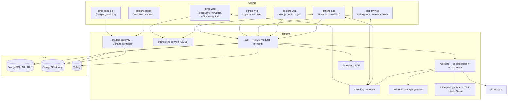

# Architecture overview

Status: Draft · Last updated: 2026-11-08 · Owner: product owner
Sources: RN-05, RN-06, RN-14, RN-15, RN-16, RN-17, RN-19

The shape of the system in one page: surfaces, backend contexts, data and tenancy, cross-cutting concerns and the technology per layer. Each choice is recorded in an [ADR](../adr/README.md); this page links them and does not repeat their reasoning. Requirements live in the [domain docs](../domain/).

## System context



## Repository layout (target)

```
apps/      api · clinic-web · admin-web · display-web · booking-web · patient_app (Flutter)
packages/  contracts · api-client-ts (generated) · api_client_dart (generated) · db
           tokens · ui (Base UI design system) · shifa_ui (Flutter design system)
           i18n · domain-* (pure rules: money, queue, dental, ortho, …) · testing (synthetic data)
docs/      product · domain · architecture · adr · compliance · process · slices · specs · research
```
Monorepo with pnpm + Turborepo; Flutter pinned with FVM ([ADR-0002](../adr/README.md)).

## Backend bounded contexts

One deployable NestJS application with strict module boundaries, enforced by lint and architecture tests ([ADR-0003](../adr/README.md)). Modules talk through public interfaces and events written to a transactional outbox.

| Context | Owns | Domain doc |
|---|---|---|
| identity | users, sessions, MFA, phone verification | [messaging-and-verification](../domain/messaging-and-verification.md) |
| tenancy | tenants, organizations, branches, resources, memberships, practitioner roles | [platform-and-configuration](../domain/platform-and-configuration.md) |
| configuration | entitlements, feature flags, cascading settings, custom fields, branding | same |
| patients | global patient accounts, per-clinic charts, family links, matching | [clinical-records](../domain/clinical-records.md), [patient-app](../domain/patient-app.md) |
| scheduling | availability, appointments, queue, tickets, displays, voice calls | [scheduling-queue](../domain/scheduling-queue.md), [voice-calling](../domain/voice-calling.md) |
| clinical | encounters, notes, templates, prescriptions, reports, consents | [clinical-records](../domain/clinical-records.md) |
| dental | odontogram, perio, ortho, endo, implants, plans, lab cases | [dental](../domain/dental.md) |
| orthopedics | body chart, episodes, fractures, procedures, PROMs | [orthopedics](../domain/orthopedics.md) |
| imaging | studies metadata, gateway, share links | [imaging](../domain/imaging.md) |
| billing | prices, invoices, receipts, rates, cash sessions, commissions | [billing-multicurrency](../domain/billing-multicurrency.md) |
| notifications | push, in-app inbox, WhatsApp sessions and queues | [messaging-and-verification](../domain/messaging-and-verification.md) |
| documents | files, PDFs, print templates | — |
| reporting | read models and exports | per domain |
| audit | append-only audit and access log | [data handling](../compliance/data-handling.md) |

## Data and tenancy

- Shared PostgreSQL schema; every tenant row carries `tenant_id` (and `branch_id` where relevant); Row-Level Security with `FORCE`, the tenant context set per transaction, and the application connecting as a non-owner role ([ADR-0004](../adr/README.md), [ADR-0005](../adr/README.md)).
- A tenant routing table allows moving a large group to a dedicated database later.
- Global identities: one practitioner across clinics; one patient account linked to per-clinic charts; no automatic merging across clinics ([ADR-0006](../adr/README.md)).
- Custom fields in JSONB validated against a definitions registry ([ADR-0008](../adr/README.md)); versioned clinical templates store `template url|version` with every record ([ADR-0009](../adr/README.md)).
- Money in integer minor units with per-transaction rate snapshots ([ADR-0018](../adr/README.md)).
- Double booking prevented by exclusion constraints; slot holds with expiry.

## Cross-cutting concerns

| Concern | Approach | ADR |
|---|---|---|
| API contract | REST + OpenAPI 3.1 from named Zod schemas; generated TS and Dart clients; drift check in CI | 0013 |
| Realtime | Centrifugo channels per tenant/branch, fed from the outbox; clients refetch on "changed" signals | 0015 |
| Offline | Reception (today's queue, walk-ins, cash, printing) and patient app tolerate outages; engine chosen by spike | 0014 |
| Notifications | Push + in-app inbox primary; WhatsApp gateway secondary; no SMS | 0017 |
| Identity | Better Auth; reverse WhatsApp verification; MFA for owners and super admins | 0016 |
| Imaging | Orthanc per tenant behind our gateway (AGPL boundary: no custom code inside Orthanc); OHIF viewer | 0019 |
| Voice | Voice packs generated server-side outside Syria, cached on displays, played locally | 0020 |
| Files, cache, PDFs, search | Garage, Valkey, Gotenberg, Postgres search with Arabic normalisation | 0021 |
| Design system | DTCG tokens → CSS/Tailwind and Dart; Base UI components; Flutter design system from the same tokens | 0011, [design-system](design-system.md) |
| Security | Audit of every record read; deny rules and hooks in development; no real patient data in dev | 0023 |
| Licensed content | PROMs and AO/OTA gated per tenant licence | 0024 |

## Environments and deployment

- Environments: local (WSL2), CI, staging (synthetic data only), production.
- Docker Compose deployed with Kamal; fully portable so the primary can move into Syria if the law requires it ([ADR-0022](../adr/README.md), OD-01).
- Backups: pgBackRest point-in-time recovery to a second provider, plus object storage and Orthanc storage backups; quarterly restore drills.
- Observability: OpenTelemetry → Grafana stack; GlitchTip for errors; secrets in Infisical.

## Technology summary

| Layer | Choice | ADR |
|---|---|---|
| Language | TypeScript (backend, web); Dart (patient app) | 0002, 0012 |
| Backend | NestJS 12, pg-boss | 0003 |
| Database / ORM | PostgreSQL 18, Drizzle | 0004, 0005 |
| Web apps | React 19, Vite, TanStack Router/Query/Table, React Hook Form + Zod; Next.js 16 for public pages; MapLibre + OSM; i18next | 0010 |
| Design system | Base UI + DTCG tokens (Style Dictionary) + Tailwind v4; Storybook | 0011 |
| Mobile | Flutter (MVVM, Riverpod 3, go_router, freezed, drift + SQLCipher) | 0012 |
| Realtime | Centrifugo | 0015 |
| Auth | Better Auth | 0016 |
| Messaging | FCM, WAHA (GOWS engine) | 0017 |
| Imaging | Orthanc, OHIF, Cornerstone3D | 0019 |
| Voice | Azure ar-SY TTS (generation only), SILMA fallback | 0020 |
| Infra | Garage, Valkey, Gotenberg, ExcelJS, Docker Compose + Kamal, pgBackRest, OpenTelemetry, GlitchTip, Infisical | 0021, 0022 |
