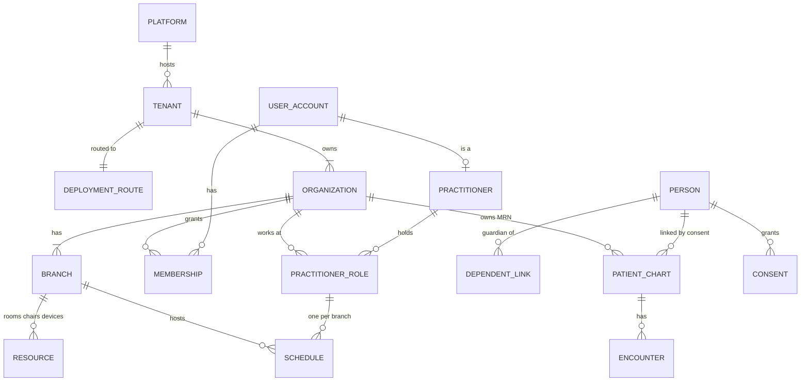
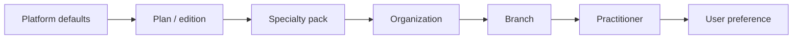
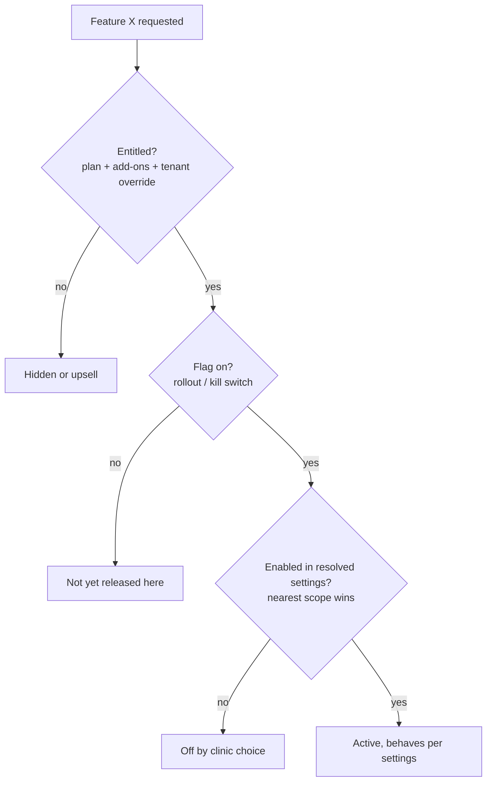
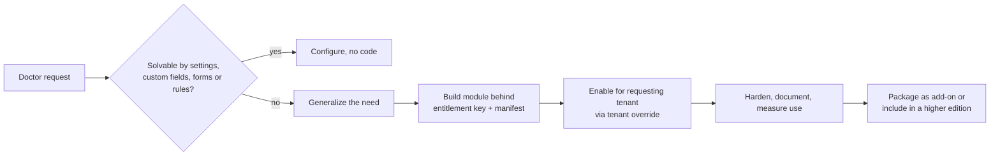
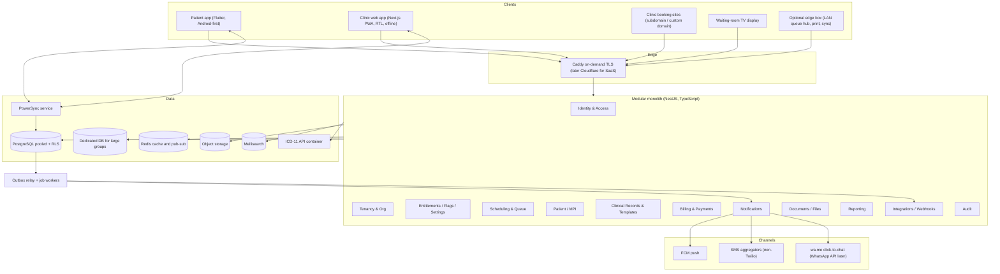

# نواةٌ واحدة قابلة للتشكيل تكسب عيادات حلب وإعزاز

رأيي المهني أن الفكرة قابلة للتنفيذ وتوقيتها مناسب، لكن نجاحها لن يُحسم بكثرة خيارات التخصيص، بل بثلاثة أمور: **نموذج بيانات واحد** يخدم الطبيب المنفرد والعيادة متعددة الأطباء والمجمّع متعدد الفروع دون أنظمة منفصلة، و**نواة تشغيلية تدمج المواعيد مع «نظام الدور»** وتستمر في العمل عند انقطاع الكهرباء والإنترنت، و**معمارية تلتف على قيود المنصات العالمية** التي ما زالت تستثني سوريا عملياً رغم رفع العقوبات قانونياً. السوق ما زال في بدايته حتى تشرين الثاني 2026: أبرز منافس معتمد، «موعدنا»، يعلن نحو **560 طبيباً و4,500 حجز فقط، منهم 107 أطباء في حلب**، ولم أجد أي منافس يستهدف إعزاز أو ريف حلب الشمالي ([Moadna](https://moadna.com/)). في المقابل، **منصة WhatsApp Business لا تخدم سوريا مُرسِلاً ولا مُستقبِلاً**، وأوقفت Twilio الرسائل النصية إليها منذ 15 أيلول 2025، ويستثني Google Play Console سوريا على مستوى بلد الحساب؛ وهذه قيود تصميم لا تفاصيل تشغيل ([Meta](https://developers.facebook.com/documentation/business-messaging/whatsapp/support); [Twilio](https://www.twilio.com/en-us/guidelines/sy/sms); [UnblockSyria](https://unblocksyria.com/en/services/google-play-console)). المعمارية التي أوصي بها هي Modular Monolith بلغة TypeScript (NestJS) فوق PostgreSQL مشتركة معزولة بـ Row-Level Security (RLS) مع جدول توجيه يسمح لاحقاً بنقل مجمّع كبير إلى قاعدة مخصّصة، وثلاث طبقات تكوين منفصلة (Entitlements وFeature flags وSettings) بتسلسل وراثة واضح، ومحرك قوالب سريرية مثبّتة الإصدارات على نمط FHIR Questionnaire مع «حزم تخصصية» تبدأ بطب الأسنان وطب الأطفال، وتطبيق عيادة PWA يعمل دون اتصال عبر PowerSync، وتطبيق مرضى بـ Flutter. تجارياً، ترجّح الأدلة اشتراكاً شهرياً لكل طبيب مع تطبيق مرضى مجاني وتأجيل نموذج العمولة. أما الخطر الأكبر فليس تقنياً: اتساع النطاق، وتحوّل «ميزة الطبيب الواحد» إلى فخ صيانة، وصعوبة إقناع عيادات تُدار بالسكرتيرة والدفتر الورقي؛ لذلك يجب أن يبدأ المشروع بعمل ميداني وبنسخة أولى (MVP) ضيقة ومنضبطة.

## سوق حلب وإعزاز شبه فارغ، والعائق فيه تنفيذي لا تنافسي

المنافسة السورية حديثة وصغيرة الحجم إلى حد لافت. «موعدنا» (دمشق، تأسست 2025) جمعت **50 ألف دولار فقط بتقييم 300 ألف**، وأعلنت في حزيران 2026 أكثر من 550 مقدّم خدمة و3,500 حجز منذ انطلاقها ([Wamda](https://www.wamda.com/en/2026/06/syrian-healthtech-moadna-raises-50000-early-stage-funding))، ثم حصلت في آب 2026 على **موافقة وزارة الصحة وموافقة مؤقتة من الهيئة الوطنية لخدمات تقانة المعلومات (NAITS)** ريثما تستكمل الاعتماد النهائي ([MENA Startup Digest](https://menastartupdigest.com/?p=48912)). يُظهر دليلها 203 أطباء في دمشق مقابل 107 فقط في حلب، ويتصدّر طب الأسنان تخصصاتها بـ 290 مدرجاً ([Moadna](https://moadna.com/)). أما «DoctorBook» فتأسست في 2026 بتمويل أولي قدره 16 ألف دولار وأكثر من 200 طبيب، ولم تبدأ معالجة الحجوزات إلا مؤخراً ([Wamda](https://www.wamda.com/2026/07/syrian-healthtech-doctorbook-raises-16000-pre-seed-round)). وتبني «روشتة» نموذجها على **حجز الدور وتتبع تقدّمه عن بُعد**، مع دفع أجرة المعاينة للطبيب في العيادة، وتطبيقات على المتجرين وPWA ونظام لإدارة المشافي ([Roshtah](https://www.roshtah.com/%D8%A7%D8%AD%D8%AC%D8%B2-%D8%B7%D8%A8%D9%8A%D8%A8)). لم أجد أثراً لعمالقة المنطقة (Vezeeta وOkadoc وAltibbi) داخل سوريا.

| المنافس | التموضع | الأرقام المعلنة | ما يعنيه لمشروعك |
|---|---|---|---|
| موعدنا (Moadna) | حجز + إدارة عيادة، مركزه دمشق | نحو 560 طبيباً، 12,000+ مستخدم، 4,500+ حجز؛ 107 أطباء في حلب | يملك موافقة الوزارة وموافقة NAITS المؤقتة، وهذا معيار امتثال يجب مجاراته سريعاً |
| روشتة (Roshtah) | حجز دور مع تتبع مباشر + نظام مشافٍ | غير معلنة | تتبّع الدور ليس ميزة حصرية، والتمايز يجب أن يأتي من العمق |
| DoctorBook | دليل أطباء وحجز | 200+ طبيب، تمويل 16 ألف دولار | منافس ناشئ جداً |
| غياب كامل | إعزاز وريف حلب الشمالي | — | سوق غير مخدوم يحتاج الليرة التركية والأرقام التركية |

الطلب يتّجه إلى القطاع الخاص لأسباب بنيوية. وفق HeRAMS 2025، **57% فقط من المشافي و30% من مراكز الرعاية الأولية في سوريا تعمل بكامل طاقتها** ([Syria HNRP 2026](https://humanitarianaction.info/plan/1518/document/syria-humanitarian-needs-and-response-plan-2026/article/35-health-3))، وتوقّعت مجموعة الصحة التابعة لمنظمة الصحة العالمية في حزيران 2025 نفاد تمويل 172 منشأة في الشمال الغربي ([WHO Health Cluster](https://healthcluster.who.int/newsroom/news/item/12-06-2025-holding-the-line-how-the-health-cluster-keeps-northwest-syria-s-fragile-health-system-from-collapse)). وفي إعزاز تحديداً أضرب العاملون الصحيون في شباط 2026 بعد خمسة أشهر بلا رواتب، وكان 28 مركزاً تابعاً للوزارة في المنطقة غير مفعّل ولم يعمل إلا ثلاثة مراكز، فيما توقّف معظم المراكز الموروثة من الإدارة التركية لانتهاء عقودها، قبل أن ينتهي الإضراب بتفاهم إداري في اليوم التالي ([تلفزيون سوريا](https://www.syria.tv/%D8%B1%D9%88%D8%A7%D8%AA%D8%A8-%D9%85%D8%AA%D8%A3%D8%AE%D8%B1%D8%A9-%D9%88%D8%AE%D8%AF%D9%85%D8%A7%D8%AA-%D9%85%D9%87%D8%AF%D8%AF%D8%A9-%D9%85%D8%B9-%D8%A7%D8%B3%D8%AA%D9%85%D8%B1%D8%A7%D8%B1-%D8%A7%D9%84%D8%A5%D8%B6%D8%B1%D8%A7%D8%A8-%D9%85%D8%A7-%D8%B9%D9%88%D8%A7%D8%A6%D9%82-%D8%AF%D9%85%D8%AC-%D9%82%D8%B7%D8%A7%D8%B9-%D8%A7%D9%84%D8%B5%D8%AD%D8%A9-%D9%81%D9%8A-%D8%A7%D8%B9%D8%B2%D8%A7%D8%B2%D8%9F); [تلفزيون سوريا](https://www.syria.tv/%D8%B5%D8%AD%D8%A9-%D8%A7%D8%B9%D8%B2%D8%A7%D8%B2-%D8%AA%D9%86%D9%87%D9%8A-%D8%A5%D8%B6%D8%B1%D8%A7%D8%A8%D9%87%D8%A7-%D8%A8%D8%B9%D8%AF-%D8%AA%D9%81%D8%A7%D9%87%D9%85-%D8%A5%D8%AF%D8%A7%D8%B1%D9%8A-%D8%A8%D8%B4%D8%A3%D9%86-%D8%A7%D9%84%D8%B1%D9%88%D8%A7%D8%AA%D8%A8-%D9%88%D8%AF%D9%85%D8%AC-%D8%A7%D9%84%D9%85%D8%A4%D8%B3%D8%B3%D8%A7%D8%AA)). وتراوحت أجور المعاينة الخاصة في حلب في تشرين الأول 2025 بين **نحو 20 و40 دولاراً** (معاينة المسالك البولية 400 ألف ليرة قديمة ≈ 40 دولاراً، وطب أعصاب الأطفال 200 ألف) ([عنب بلدي](https://www.enabbaladi.net/776854/%D8%A3%D9%87%D8%A7%D9%84%D9%8D-%D9%8A%D8%B4%D8%AA%D9%83%D9%88%D9%86-%D8%A7%D9%84%D8%A7%D8%B1%D8%AA%D9%81%D8%A7%D8%B9-%D8%A7%D9%84%D9%85%D8%B2%D9%85%D9%86-%D9%84%D9%84%D9%85%D8%B9%D8%A7%D9%8A%D9%86/?amp=1))، مع «تغاضٍ ضمني» من نقابة الأطباء في حلب عن تجاوز التعرفة الرسمية ([Enab Baladi](https://english.enabbaladi.net/archives/2024/11/increasing-examination-fees-burden-patients-in-aleppo/)). يضاف إلى ذلك أن تركيا فرضت مساهمات صحية على السوريين تحت الحماية المؤقتة وأنهت التغطية المجانية للحالات الجديدة منذ 1 كانون الثاني 2026، وفيها نحو 2.28 مليون سوري ([UNHCR](https://www.unhcr.org/sites/default/files/2026-06/unhcr-annual-results-report-2025-turkiye.pdf))، ما يجعل «الحجز والدفع للأهل من الخارج» حالة استخدام حقيقية في الشمال.

المنتجات الغربية تتنافس اليوم على الفوترة التأمينية والكاتب الطبي الذكي (AI scribe)، وكلاهما شبه عديم الصلة في حلب. الأقرب إلى الواقع السوري هو ما تقدّمه Practo Ray في الهند: إدارة طوابير الانتظار والمعاينة، والوصفات بقوالب، والفواتير مع تتبّع الذمم، والفروع المتعددة ([Techjockey](https://www.techjockey.com/detail/practo-ray)). وتحمل مراجعات تطبيق Vezeeta درساً مباشراً: عيادة استخدمت نظامها الخاص وعاملت حجز التطبيق كأنه مراجع بلا موعد، ولم يحلّ الدعم المشكلة ([App Store](https://apps.apple.com/eg/app/vezeeta/id1010281314)). الخلاصة أن تطبيق الحجز المنفصل عن نظام العيادة يفشل، وأن **نظام العيادة الذي تستخدمه السكرتيرة يجب أن يكون مصدر الحقيقة الوحيد** للمواعيد والدور معاً.

وهنا تصحيح لافتراض كان سيدخل في توصياتي: **عرض موقع المريض في الدور مباشرة ليس ميزة فريدة في سوريا**. صحيح أن المنصات العالمية الكبرى لم توثّق تتبّع الدور من جهة المريض، لكن «روشتة» تقدّمه محلياً. التمايز الحقيقي إذن في العمق والتكامل: دور ومواعيد في محرك واحد داخل نظام العيادة، يعمل دون إنترنت، مع شاشة انتظار وتذكرة مطبوعة برمز QR، وعملتين، وأرقام هواتف سورية وتركية، والتحقق من ترخيص الطبيب قبل إدراجه للعامة.

## نموذج بيانات واحد يجعل الطبيب المنفرد «مجمّعاً بحجم واحد»

المبدأ الحاكم: **لا تبنِ ثلاثة أنظمة**. الطبيب المنفرد هو مستأجر (Tenant) لديه منظمة واحدة وفرع واحد وممارس واحد، والعيادة متعددة الأطباء هي المستأجر نفسه مع عدة ممارسين، والمجمّع هو المستأجر نفسه مع عدة فروع. ما يتغيّر هو الواجهة لا البيانات: تتكيّف حسب «الإصدار» (Edition) وبمبدأ الكشف التدريجي، فلا يرى الطبيب المنفرد مبدّل الفروع ولا إدارة الغرف حتى يحتاجها. هذا ليس تفضيلاً جمالياً؛ فدليل AWS SaaS Lens يعرّف الـ SaaS بأن حتى المستأجرين المعزولين يتشاركون «الهوية والتهيئة والتجربة التشغيلية»، وأن تشغيل نسخ منفصلة لكل عميل هو نموذج «خدمة مُدارة» لا SaaS ([AWS SaaS Lens](https://docs.aws.amazon.com/wellarchitected/latest/saas-lens/silo-pool-and-bridge-models.html))، ويحذّر Azure من أن دعم أنماط نشر متعددة يتطلب قاعدة شيفرة مصمَّمة لها من البداية ([Azure](https://learn.microsoft.com/en-us/azure/architecture/guide/multitenant/considerations/tenancy-models)).

التسلسل الهرمي الموصى به هو: **Platform ← Tenant (حساب الاشتراك والفوترة) ← Organization (الكيان القانوني للعيادة أو المجموعة) ← Branch/Location (الفرع) ← Rooms/Resources (غرف، كراسي أسنان، أجهزة)**. ويتطابق هذا مع موارد FHIR: Organization للعيادة، وLocation للفرع والغرفة والكرسي، وHealthcareService للخدمة القابلة للحجز مثل «تنظيف أسنان 30 دقيقة».

الطبيب **هوية عالمية واحدة** (Practitioner: الاسم والتخصص ورقم الترخيص وحالة التحقق) مع سجل PractitionerRole لكل منظمة أو فرع يعمل فيه، يحمل أجوره وجداوله وغرفه وختمه وتوقيعه هناك؛ فالطبيب الذي يعمل صباحاً في مشفى ومساءً في عيادتين يدخل بحساب واحد ومبدّل للعيادات. ويحذّر معيار FHIR من أن سجل PractitionerRole متعدد المواقع يفرض التوفر نفسه على كل المواقع، لذا يجب أن يُنمذَج التوفر لكل زوج (طبيب، موقع) ([HL7 FHIR PractitionerRole](https://hl7.org/fhir/R5/practitionerrole.html)). تدعم أنظمة الهوية الحديثة نموذج «مستخدم واحد في منظمات متعددة» أصلاً، فقد صارت Organizations مدعومة بالكامل في Keycloak 26 ([Keycloak](https://github.com/keycloak/keycloak/issues/30180))، وتسمح Better Auth منذ 1.3 بانتماء العضو إلى عدة فرق ([Better Auth](https://better-auth.com/blog/1-3))؛ لكن لا أحد منها ينمذج «منظمة ← فرع ← غرفة»، لذا تبقى صلاحيات الفرع والغرفة في جداول التطبيق.

المريض بدوره **حساب عالمي على المنصة** (دخول برمز OTP على الهاتف، وأفراد أسرة تابعون تحت رقم واحد، وإمكانية رقمين سوري وتركي) يرتبط بـ **ملف طبي مستقل في كل عيادة** يحمل رقم ملفها (MRN). تنشئ السكرتيرة المريض على المكتب دون حساب، ثم «يطالب» المريض بملفه لاحقاً عبر OTP على الرقم المسجّل أو رمز QR مطبوع على الإيصال. ولأن عملية `$match` في FHIR «لا تحدد أي خوارزمية» ([HL7](https://www.hl7.org/fhir/R4/operation-patient-match.xml.html))، يجب بناء مطابقة احتمالية تراعي الأسماء العربية (الهمزات والتاء المربوطة وابن/بن واسم الأب والجد والأم)، مع قاعدة صارمة: **لا دمج تلقائياً بين العيادات أبداً**، والربط يؤكده المريض أو موظف مع تسجيل تدقيقي.

السجل الطبي **ملك العيادة** وهو سجلها القانوني، ويرى المريض في تطبيقه ما أفرجت عنه العيادة (الوصفات والملخصات الموقّعة والنتائج)، ولا تُشارك أي معلومة مع عيادة أخرى إلا **بموافقة صريحة من المريض** محددة النطاق والمدة وقابلة للسحب، مع استبعاد الفئات الحساسة افتراضياً.



| نوع العميل | Tenant | Organization | Branch | الممارسون | ما تُظهره الواجهة |
|---|---|---|---|---|---|
| طبيب منفرد | 1 | 1 | 1 ضمني | 1 | لا مبدّل فروع ولا إدارة غرف؛ شاشة سكرتيرة مبسطة |
| عيادة متعددة الأطباء | 1 | 1 | 1 | 2–20 | جداول متعددة، غرف وموارد، أدوار وصلاحيات، تقسيم إيرادات |
| مجمّع متعدد الفروع | 1 | 1 أو أكثر | 2 أو أكثر | كثيرون | مبدّل فروع، أسعار وعملة لكل فرع، تقارير مجمّعة، خيار قاعدة مخصّصة |

## PostgreSQL مشتركة بعزل RLS صارم، مع باب خروج إلى قاعدة مخصّصة

تتفق أدلة AWS وAzure على أن العزل طيف لا خيار ثنائي، وأن الافتراض الأمثل هو نموذج «مشترك» (Pool) مع إمكانية وضع مستأجرين بعينهم على موارد مخصّصة (Silo) لاحقاً. ويصف Azure اختيار نموذج المستأجرين بأنه «ليس قراراً تقنياً فقط، بل تجاري أيضاً»، ويقترح أن تُتقاضى رسوم أعلى مقابل النشر المخصّص، وأن يُفصل المستأجر المنطقي عن «وحدة النشر» عبر **جدول تعيين (tenant ← deployment)** يتيح نقل المستأجرين بين وحدات النشر متى شئت ([Azure](https://learn.microsoft.com/en-us/azure/architecture/guide/multitenant/considerations/tenancy-models)). وبما أن غالبية عملائك سيكونون أطباء منفردين، فالنموذج المشترك هو الوحيد المعقول اقتصادياً: قاعدة PostgreSQL واحدة، و`tenant_id` على **كل** صف بما فيها جداول الربط، وجدول توجيه من اليوم الأول.

النمط القياسي موثّق لدى AWS: تفعيل RLS لكل جدول، وسياسة تقارن `tenant_id` بـ `current_setting('app.current_tenant')`، وتعيين المتغير عند كل تسليم للاتصال، وتجنّب دور قاعدة بيانات لكل مستأجر. لكن الشيطان في التفاصيل: المستخدم الخارق والأدوار ذات `BYPASSRLS` لا تخضع للسياسات، ومالك الجدول يتجاوزها ما لم يُطبَّق `FORCE ROW LEVEL SECURITY`، لذا يجب أن يتصل التطبيق بدور لا يملك الجداول ([AWS Database Blog](https://aws.amazon.com/blogs/database/multi-tenant-data-isolation-with-postgresql-row-level-security/)). الجدول التالي يلخّص الفخاخ الموثقة وعلاجها:

| الفخ | ما يحدث فعلاً | العلاج الموصى به |
|---|---|---|
| `SET` على مستوى الجلسة خلف PgBouncer بنمط transaction pooling | يتسرّب سياق المستأجر إلى العميل التالي؛ في اختبار منشور رأى عميل بلا مستأجر **267,023 فاتورة** لأكبر مستأجر ([now-next.nl](https://now-next.nl/en/insights/postgresql-row-level-security-multi-tenant-saas/)) | `set_config('app.current_tenant', $1, true)` داخل معاملة صريحة، ويفضَّل في الدفعة نفسها مع الاستعلام |
| `SET LOCAL` خارج معاملة صريحة | لا يفعل شيئاً بصمت ([daily.dev](https://daily.dev/posts/pgbouncer-and-rls-tenant-context-set-local-shared-plans-wvpn1fj2i)) | غلاف معاملة إلزامي لكل طلب ومهمة، والفشل مغلقاً إن لم يُعيَّن المستأجر |
| قيود UNIQUE وPK وFK تتجاوز RLS | يمكن ربط بند بفاتورة مستأجر آخر، وتكشف أخطاء القيود وجود صفوف لغيرك ([Bytebase](https://www.bytebase.com/blog/postgres-row-level-security-footguns/)) | مفاتيح أجنبية مركّبة تتضمن `tenant_id`، وقيود تفرّد ضمن المستأجر |
| Views يملكها دور متجاوز | تسرّب كل المستأجرين ([Bytebase](https://www.bytebase.com/blog/postgres-row-level-security-footguns/)) | `security_invoker = true` |
| `WITH CHECK (true)` أو غيابه | يُدرج مستأجر صفوفاً باسم آخر | `WITH CHECK` صريح مطابق لسياسة القراءة |
| فهارس لا يتصدّرها `tenant_id` | مسح تسلسلي: نحو 120 ملّي ثانية مقابل 1 ملّي ثانية في قياس منشور ([dev.to](https://dev.to/software_mvp-factory/postgresql-row-level-security-without-the-performance-tax-436g)) | `tenant_id` أول عمود في كل فهرس مركّب |
| خطط استعلام مشتركة خلف PgBouncer | خطة مستأجر كبير تُستخدم لصغير: 7.6 مقابل 0.62 ملّي ثانية ([daily.dev](https://daily.dev/posts/pgbouncer-and-rls-tenant-context-set-local-shared-plans-wvpn1fj2i)) | مراقبة الاستعلامات الساخنة، وتجربة فرض خطط مخصّصة لها (اقتراح من خبرة عامة يُختبر) |
| خطافات ORM تعيّن السياق على اتصال وتستعلم على آخر | السياق يضيع أو يتسرب | معاملة واحدة تغلّف تعيين السياق والاستعلامات |
| RLS ترشّح القراءة بصمت | نتائج فارغة لا أخطاء | اختبارات صريحة ومراقبة |

لذلك أعامل RLS كـ **دفاع في العمق لا كخط وحيد**: طبقة التطبيق تقيّد كل استعلام بالمستأجر (مستودعات أو نطاقات ORM عامة)، وRLS تلتقط الأخطاء، واختبارات تسرّب آلية بين المستأجرين تعمل في CI، كما يوصي Azure باختبار العزل صراحةً. وتنصح وثائق Supabase بفهرسة كل عمود تستخدمه السياسات، ولفّ الدوال بصيغة `(select ...)` ليحسبها المخطط مرة لكل استعلام لا لكل صف، وبعدم إيصال مفتاح الخدمة المتجاوز لـ RLS إلى المتصفح أبداً ([Supabase](https://supabase.com/docs/guides/database/postgres/row-level-security)).

نقل مجمّع كبير إلى قاعدة مخصّصة يصبح إجراءً روتينياً إذا التزمت بثلاثة شروط منذ البداية: المخطط نفسه في القاعدتين، والإبقاء على `tenant_id` حتى في القاعدة المخصّصة، ومعرّفات فريدة عالمياً (UUIDv7) بدل التسلسلات. يصبح النقل حينها: إنشاء القاعدة من الترحيلات نفسها، ونسخ صفوف المستأجر (أو النسخ المنطقي بمرشحات صفوف المتاح منذ PostgreSQL 15، وهذه معلومة لم يُعَد التحقق منها في البحث)، وتجميد كتابة قصير، وقلب سجل التوجيه، ثم حذف الصفوف من القاعدة المشتركة بعد التحقق. وإن احتجت التوسع أفقياً لاحقاً، يتيح Citus عزل مستأجر في شريحة مستقلة ونقلها إلى عقدة مخصّصة، مع استمرار الكتابة منذ الإصدار 11.1 ([Citus](https://www.citusdata.com/blog/2022/09/19/citus-11-1-shards-postgres-tables-without-interruption/)). وتذكّر أن الاستعادة الزمنية (PITR) تعيد العنقود كله لا مستأجراً واحداً، لذا يلزم **مهمة «تصدير مستأجر» مختبَرة** تخدم أيضاً حق نقل البيانات والهجرة إلى قاعدة مخصّصة. وهذه الآلية نفسها تحوّطٌ مهم: إذا فرضت سوريا مستقبلاً استضافة البيانات الصحية محلياً، وهو احتمال وارد في ظل خطاب «مراكز البيانات السيادية» ومسار اعتماد NAITS، تُنشئ «خلية سورية» وتنقل إليها المستأجرين المعنيين دون إعادة كتابة.

## ثلاث طبقات لا تختلط: ما دفع العميل ثمنه، وما أُطلق تقنياً، وكيف تعمل الميزة

متطلبك بأن «يشغّل مالك المنصة ميزات لكل عيادة ويطفئها» هو في الحقيقة ثلاثة مفاهيم مختلفة، وخلطها هو أسرع طريق إلى فوضى `if (tenant == X)`. تقول Schematic إن الأعلام (Feature flags) «تُستخدم للإطلاق التدريجي واختبارات A/B، بينما الاستحقاقات (Entitlements) تتعلق بما دفع العميل ثمنه» ([Schematic](https://schematichq.com/blog/billing-vs-entitlements-whats-the-difference)).

| المفهوم | يجيب عن سؤال | من يملكه | عمره | مثال من منصتك |
|---|---|---|---|---|
| Entitlements | ما الذي يحق لهذا العميل تجارياً؟ | المالك والمبيعات والفوترة | طوال الاشتراك | `pack.dental = true`، `custom_fields.max = 50`، `branches.max = 3` |
| Feature flags | هل الشيفرة الجديدة مفعّلة في هذا السياق؟ | فريق الهندسة | قصير (أسابيع) | إطلاق `queue_v2` لـ 10% من العيادات، أو مفتاح إيقاف طارئ |
| Settings | كيف تتصرف الميزة هنا؟ | العيادة ضمن حدود | دائم | مدة الموعد الافتراضية، عملة الفرع، إدخال مراجع بلا موعد بعد كل موعدين |

تُحسب الاستحقاقات من الخطة الأساسية، ثم الإضافات (Add-ons)، ثم الاستثناءات الخاصة بالمستأجر. في نموذج Stigg، الإضافة إما **تزيد** حدّ الخطة أو **تستبدله**، وعند تعارض الاستبدالات تُعتمد القيمة العليا ([Stigg](https://docs.stigg.io/documentation/managing-customers-and-subscriptions/entitlements/entitlement-calculation.md))، وتأخذ Schematic «القيمة الأكثر سخاءً» بين الخطة والاستثناء ([Schematic Docs](https://docs.schematichq.com/feature-management/overview)). القاعدة التي أوصي بها: استثناء المستأجر الصريح، ثم أعلى قيمة بين إضافات الاستبدال، ثم الخطة مع مجموع إضافات الزيادة، ثم الخطة الأم، وإلا فالرفض افتراضياً؛ وتُخزَّن النتيجة مؤقتاً لكل مستأجر وتُبطَل عند تغيّر الاشتراك. يبدأ ذلك بجداول تملكها أنت (`plan` و`plan_feature` و`addon` و`tenant_override` مع سبب وتاريخ انتهاء)، ولا داعي لخدمات مثل Stigg أو Schematic التي تُفوتر بالدولار إلا إذا ثقلت تجارب التسعير والقياس.

الإعدادات تُحلّ عبر سلسلة وراثة تتقدّم فيها القيمة الأقرب:



لكل مفتاح إعداد بيانات وصفية: من يحق له تجاوزه (`overridable_by`)، وهل قفله المستوى الأعلى (`locked`، فيمنع مدير المجمّع الفروع من تغيير سياسة الإلغاء مثلاً)، ومخطط JSON Schema للتحقق، ودرجة الحساسية. ويجب أن تُظهر واجهة الإدارة مصدر كل قيمة («موروثة من: حزمة الأسنان»). وتكون الميزة ظاهرة فقط إذا اجتمعت الطبقات الثلاث:



للأعلام أوصي بتصميم متوافق مع OpenFeature منذ البداية: مزوّد داخلي بسيط فوق جدول في البداية، ثم Unleash أو Flagsmith أو GrowthBook مستضافاً ذاتياً عند الحاجة، فلكل منها مزوّد OpenFeature ([DeployHQ](https://www.deployhq.com/blog/feature-flag-tools-compared)). سياق التقييم في المواصفة مفتوح لحقول مخصّصة، فتمرّر `tenant_id` و`org_id` و`branch_id` والخطة والتخصص وإصدار التطبيق ([OpenFeature](https://openfeature.dev/specification/sections/evaluation-context)). والقاعدة الذهبية: **أي اختلاف دائم بين العملاء مكانه الاستحقاقات أو الإعدادات، لا الأعلام**، وإلا صارت الأعلام `if (tenant == X)` مقنّعة.

وماذا عن «ميزة لطبيب واحد داخل عيادة متعددة الأطباء»؟ الاستحقاق تجاري ويُمنح للمستأجر الذي يدفع، أما نطاق التفعيل فيُضيَّق عبر سلسلة الإعدادات إلى مستوى الممارس. هكذا تشتري العيادة الميزة ويفعّلها طبيب واحد فقط، وإذا عمل هذا الطبيب في عيادة ثانية لا تتبعه الميزة إلا إذا امتلكتها تلك العيادة. وأداة المالك هي **لوحة إدارة المنصة**: استثناءات لكل مستأجر مع سبب وتاريخ انتهاء وسجل تدقيق، ومفاتيح إيقاف طارئ، وعرض لما يملكه كل عميل ولماذا.

## الميزة التي يطلبها طبيب واحد تُبنى مرة وتُباع مرات

النمط المجرَّب هو: **شيفرة واحدة ونشر واحد، والسلوك الخاص بالعميل إما ميزة عامة خلف استحقاق، أو إعداد، أو امتداد عند نقطة امتداد محددة**. تمثّل Shopify Functions الطرف الأقصى من هذا الطيف: منطق الشركاء يُحقن فقط عند «أهداف» (Targets) تحددها المنصة، بمدخلات JSON مكتوبة الأنواع، مُترجماً إلى WebAssembly، ولا يُستدعى برابط مباشر بل تستدعيه Shopify وحدها ([Shopify](https://shopify.dev/docs/apps/build/functions)). في المقابل، الأنماط المحظورة عندك واضحة: لا فروع Git لعميل بعينه، ولا `if (tenantId === 'X')` في الشيفرة، ولا تباين في مخطط القاعدة بين المستأجرين، ولا أعلام تتحوّل إلى إعدادات دائمة، ولا ترقيعات SQL يدوية في الإنتاج لعميل واحد؛ فكل واحد منها يضاعف اختبارات الانحدار ويعطّل الترقيات.



قبل كتابة أي سطر، يمر الطلب على «سلّم نقاط الامتداد» من الأرخص إلى الأغلى. معظم طلبات الأطباء تُحلّ في الدرجات الأولى دون شيفرة جديدة:

| الدرجة | الأداة | مثال من عيادة | من ينفّذ |
|---|---|---|---|
| 1 | الإعدادات | تغيير مدة المعاينة أو قاعدة إدخال المراجعين بلا موعد | العيادة |
| 2 | الحقول المخصّصة | «رقم الملف الورقي القديم» أو «جهة الإحالة» | العيادة |
| 3 | الاستمارات والقوالب | استمارة تقييم سمنة أو تقييم ما قبل التخدير | العيادة أو فريق الدعم |
| 4 | قوالب الطباعة | ترويسة وصفة بشعار وختم وتنسيق A5 | العيادة |
| 5 | قواعد الأتمتة (JSON: شروط ثم أفعال) | «إذا كان نوع الموعد جراحة: اطلب نموذج موافقة وعربوناً» | العيادة ضمن حدود |
| 6 | Webhooks وأحداث عبر Outbox | إرسال الموعد إلى نظام مختبر خارجي | مطوّر خارجي |
| 7 | وحدة تبنيها المنصة خلف استحقاق | تصدير مطالبات لشركة تأمين بعينها عبر واجهة `ClaimExporter` | فريق المنصة |
| 8 (لاحقاً جداً) | دوال معزولة (WASM) بحدود معالجة وذاكرة | منطق تسعير خاص لشريك | شركاء موثوقون |

كل وحدة تُعرَّف بملف وصفي (Manifest) يحوي المفتاح والإصدار والاستحقاقات المطلوبة ومخطط إعداداتها والأحداث التي تشترك فيها والصلاحيات. وتمرّ الأحداث عبر نمط **Transactional Outbox**: تُكتب الرسالة في جدول داخل المعاملة نفسها مع بيانات العمل ثم تُرحَّل، والتسليم «مرة على الأقل»، لذا يجب أن يكون المستهلك متساوي الأثر (Idempotent) ([microservices.io](https://microservices.io/patterns/data/transactional-outbox.html)).

تعاقدياً، يجب أن ينص عقد الخدمة على أن **أي تطوير يموّله العميل ينتج ملكية فكرية للمنصة** يجوز تقديمها لعملاء آخرين، مع رسم تطوير اختياري لمرة واحدة، ونافذة حصرية اختيارية (6–12 شهراً) مسعّرة صراحةً إن طلبها العميل؛ أما بيانات العميل وإعداداته فتبقى له، والمواد التي يقدمها (شعارات وترويسات) مرخّصة للمنصة لغرض تقديم الخدمة فقط. هذه ممارسة عامة في عقود SaaS لا رأي قانوني، ويجب أن يراجعها محامٍ مطّلع على القانون السوري وقانون بلد الكيان. وأنصح بحوكمة بسيطة: لوحة طلبات تُقيَّم بثلاثة أسئلة (هل تفيد عيادات أخرى؟ هل تتسق مع خارطة الطريق؟ هل يغطي الرسم كلفتها؟)، وحدّ أقصى لعدد الوحدات المخصّصة التي تدخل التطوير كل ربع سنة، و«لا» افتراضية لكل طلب لا يجتاز الاختبار.

## الحقول المخصّصة: سجلّ تعريفات وJSONB وسقف 50 حقلاً لكل كيان

الخيار العملي في PostgreSQL هو **تعريفات حقول وصفية في جدول مستقل، وقيم مخزّنة في عمود JSONB على الكيان المالك**، يُتحقق منها في التطبيق مقابل التعريف. لكن لهذا الخيار حدوداً موثقة: PostgreSQL لا يحتفظ بإحصاءات عن القيم داخل JSONB فيستخدم تقديراً ثابتاً قدره 0.1%، وفي اختبار Heap أدى سوء التقدير إلى **584 ثانية مقابل نحو 300 ملّي ثانية** للنسخة المعتمدة على الأعمدة، وشغل الجدول 164 ميغابايت مقابل 79 لأن المفاتيح تتكرر في كل صف، ووفّر نقل 45 حقلاً شائعاً إلى أعمدة نحو 30% من المساحة ([Heap](https://www.heap.io/blog/when-to-avoid-jsonb-in-a-postgresql-schema)). القاعدة المستخلصة: البيانات الموجودة في معظم الصفوف أعمدة حقيقية، وJSONB للحقول الاختيارية المتفرقة. أما EAV فيُترك لحالات نادرة تحتاج تاريخاً لكل قيمة، والجداول الممتدة المكتوبة الأنواع للوحدات التخصصية التي تملكها المنصة.

سجل التعريفات يحمل لكل حقل: المستأجر، ونوع الكيان، و**مفتاحاً برمجياً ثابتاً لا يتغير** ببادئة `cf_` (على غرار `__c` في Salesforce و`x_` في Odoo ([Odoo Community](https://odoo-community.org/groups/contributors-15/contributors-1937630)))، وتسمية بالعربية والإنجليزية، ونوعاً من **قائمة مغلقة** (نص، نص طويل، عدد صحيح، عشري، تاريخ، تاريخ ووقت، منطقي، اختيار مفرد، اختيار متعدد، هاتف، بريد، ملف، مرجع مستخدم، مرجع مريض)، وخيارات القوائم، وقواعد التحقق (إلزامي، حدود دنيا وعليا، تعبير نمطي، JSON Schema)، والقيمة الافتراضية، والعرض (القسم والترتيب والظهور في الطباعة وفي صفحة الحجز)، وأدوار العرض والتعديل، وعلامة «بيانات صحية حساسة» تُخضع الحقل لتسجيل التدقيق، والحالة مع حذف ناعم، ورقم إصدار. يُتحقق من القيم بالمخطط نفسه في الخادم والواجهة، ويُجرَّد الحقل من الاستجابة إذا لم يملك الدور صلاحية رؤيته.

للبحث، فهرس GIN على العمود بصيغة `jsonb_path_ops` يخدم استعلامات الاحتواء، أما الحقول التي تحددها العيادة «قابلة للبحث والفرز» فتحصل على فهرس تعبيري أو عمود مولَّد (`GENERATED ALWAYS AS ... STORED`) مع فهرس B-tree، وهذا يلتف أيضاً على مشكلة تقدير 0.1%. ولأن كل فهرس كلفة على الجميع، يُقيَّد عدد الحقول المفهرسة بشدة. وإذا تبيّن أن حقلاً مخصّصاً تنشئه عشرات العيادات بالمعنى نفسه، «تُرقّيه» المنصة إلى عمود أساسي بترحيل رسمي، فتتحول بيانات الاستخدام إلى خارطة طريق للنموذج الأساسي.

| الحد | Salesforce | Jira Cloud | التوصية لمنصتك |
|---|---|---|---|
| حقول مخصّصة لكل كيان | 100–255 في الإصدارات الصغيرة، 500 في Enterprise، 800 في Unlimited ([Salesforce](https://resources.docs.salesforce.com/208/latest/en-us/sfdc/pdf/salesforce_app_limits_cheatsheet.pdf)) | 700 لكل مساحة منذ آذار 2026 ([Atlassian](https://support.atlassian.com/jira-cloud-administration/docs/data-limits-and-guardrails/)) | **50** لإصداري «منفرد» و«عيادة»، و100 للمجمّعات، وسقف صلب 150 |
| حقول العلاقات | 40 لكل كائن | — | 5 (مراجع مريض أو مستخدم فقط) |
| خيارات القائمة الواحدة | — | 20,000 | 250 |
| حقول مفهرسة قابلة للبحث | — | — | **5 لكل كيان**، و10 للمجمّعات |
| الحذف | ناعم لمدة 15 يوماً ويُحتسب ضمن الحد حتى الحذف النهائي ([Salesforce](https://developer.salesforce.com/docs/platform/pkg1-dev/guide/unused-package-components.html)) | المحذوف لا يُحتسب | ناعم لمدة 30 يوماً، يُحتسب ضمن الحد، ولا يُعاد استخدام المفتاح |
| طول الوصف | — | 255 حرفاً | 255 حرفاً |

لماذا 50 وليس 500؟ لأن Salesforce وJira منصات عامة لكل شيء، أما العيادة فتحتاج عادة بضعة حقول إدارية إضافية، وكل حقل زائد يبطئ شاشة السكرتيرة على هاتف متواضع. والأهم هو **الفصل بين نوعين من التخصيص**: الحقول المخصّصة للبيانات الإدارية (المريض، الموعد/الزيارة، الفاتورة، الطبيب)، أما البيانات السريرية فتمر حصراً عبر محرك القوالب المثبّت الإصدارات في القسم التالي، لأن لها متطلبات قانونية وتحليلية لا تحتملها الحقول الحرة. وتبقى الحقول الأساسية خارج يد العيادة: لا تُحذف ولا يُعاد تسمية مفاتيحها، ويجوز إخفاء بعضها حيث لا ضرر (كالمهنة)، أما الحقول التي تعتمد عليها السلامة السريرية أو الحسابات (تاريخ الميلاد، الجنس، الحساسيات، الوزن عند الأطفال) فلا تُخفى أبداً. وتُعرض الحقول المخصّصة في التقارير عبر منشئ استعلامات يعرف التعريفات، لا عبر SQL حر.

## قوالب سريرية مثبّتة الإصدار وحِزم تخصصية تبدأ بالأسنان والأطفال

متطلب «القوالب العامة والتخصصية» يخفي مفهومين يجب فصلهما. الأول **استمارات سريرية** (تقييم، فحص، متابعة) تُبنى على محرك استمارات مثبّت الإصدارات بنمط FHIR Questionnaire/SDC. والثاني **حِزم تخصصية (Specialty Packs)**، وهي أكبر من الاستمارات: استمارات، وأدوات واجهة مخصّصة لا تعبّر عنها الاستمارة (مخطط الأسنان، منحنيات النمو)، وإعدادات افتراضية، وتقارير، وتنسيقات طباعة. وصول العيادة إلى الحزمة استحقاق تجاري، ومحتوى الحزمة إعدادات وقوالب قابلة للوراثة.

لماذا FHIR شكلاً لا خادماً؟ لأن R4 (4.0.1) ما زال الإصدار الذي يُشحن عليه كل شيء عملياً، ومنه SDC 4.0.0 وIPS 2.0.1، وR5 هو «الإصدار المنشور الحالي»، أما R6 ففي دورة اقتراع معيارية (الاقتراع الكامل الثاني في تموز 2026) بلا موعد نشر ثابت، وينقل **Invoice وChargeItem** خارج النواة ([HL7 History](https://hl7.org/fhir/history.html); [R6 Ballot](https://hl7.org/fhir/6.0.0-ballot5/ballot-intro.html)). النتيجة العملية: نموذج داخلي «بشكل FHIR» (معرّفات ثابتة، وإصدار لكل مورد، وعناصر مرمّزة)، وواجهة FHIR R4 لاحقاً، والفوترة نموذج مجال مستقل، دون تشغيل خادم FHIR كامل في البداية.

قواعد محرك القوالب غير قابلة للتفاوض. عنوان القالب القانوني (`url`) لا يتغير أبداً، وكل استجابة تخزّن **`url|version`** بالضبط، وهي الصيغة التي أكدها أحد القائمين على FHIR وأوصى بتثبيت الإصدار ([FHIR Chat](https://chat-archive.fhir.org/stream/179166-implementers/topic/Questionnaire.20versioning.20with.20canonical.20URL.html)). والإصدارات المنشورة غير قابلة للتعديل وتتعايش معاً، و**تغيير `linkId` تغيير جذري دائماً** لأنه ما يربط السؤال بالجواب، وكذلك حذف سؤال أو تبديل رمز أو نقل عناصر بين المجموعات ([Health Samurai](https://www.health-samurai.io/blog/how-to-version-a-fhir-questionnaire)). وتعمل الوراثة على ثلاث طبقات: قالب عام من المنصة، ثم قالب الحزمة التخصصية (مثلاً `pack:dental@2.1.0`)، ثم نسخة العيادة التي تشير إلى أصلها عبر `derivedFrom`، فتُعرض عليها ترقيات الأصل كفروق، ولا يُسمح لها إلا بإضافة عناصر أو إخفائها، لا بإعادة استخدام `linkId` لمعنى جديد. وعند توقيع الزيارة تُستخرج البيانات المنظمة (علامات حيوية، تشخيصات) إلى موارد على نمط Observation وCondition، ويُفضَّل الاستخراج المبني على الملاحظات أو القوالب، لأن الاستخراج عبر StructureMap «لا يستخرج شيئاً» إذا فشل الربط ([HL7 SDC](https://build.fhir.org/ig/HL7/sdc/en/extraction.html)). استبعدتُ openEHR لأن إصدار القوالب التشغيلية فيه «غير محدد» في المواصفة ([openEHR](https://openehr.atlassian.net/wiki/spaces/spec/pages/379650049/Templates+1.4+versioning+identification))، وتُثبت تجربة OpenMRS O3 أن مخطط JSON مخصّصاً بحالتَي مسودة ومنشور يعمل على نطاق واسع ([OpenMRS](https://openmrs.atlassian.net/wiki/spaces/docs/pages/68780087/Core+Concepts)). وأوصي ببناء عارض خاص للويب ولـ Flutter للتحكم الكامل في الاتجاه من اليمين إلى اليسار والأدوات المخصّصة، مع التعلّم من LHC-Forms ومكوّنات Medplum المرخّصة بـ Apache 2.0 ([Medplum](https://www.medplum.com/open-source)).

**الحزمة الأساسية العامة** يحصل عليها الجميع: ملاحظة SOAP، والعلامات الحيوية، والتشخيص، والوصفات، والمرفقات، والحساسيات وقائمة المشكلات، والتقارير والإجازات المرضية، وطباعة وصفة A5. للتشخيص، **ICD-11 هو الخيار الأقوى لمنتج عربي**: العربية لغة رسمية فيه مع متصفح عربي حي للإصدار 2025-01، والترخيص CC BY-ND 3.0 IGO يسمح بالاستخدام التجاري، وتوفر WHO حاوية Docker لواجهة ICD-API تعمل دون إنترنت ([WHO ICD](https://www.who.int/standards/classifications/classification-of-diseases); [ICD-11 Arabic](https://icd.who.int/browse/2025-01/mms/ar); [ICD-API Container](https://icd.who.int/docs/icd-api/ICDAPI-DockerContainer))، مع الإبقاء على ICD-10 للتقارير والبيانات القديمة. للمختبر، LOINC مجاني تجارياً وأضاف متغيراً عربياً في الإصدار 2.81 ([Regenstrief](https://www.regenstrief.org/article/two-new-languages-and-4000-new-concepts-in-loinc-release/)). أما SNOMED CT فمعفى من الرسوم لسوريا ما دامت مصنّفة «منخفضة الدخل» (وهي كذلك في السنة المالية 2026)، لكن **تطبيقات الويب تحتاج إذناً خاصاً** ([SNOMED](https://www.snomed.org/fee-exemptions); [Enab Baladi](https://english.enabbaladi.net/archives/2026/06/world-bank-lists-syria-among-low-income-economies/))، لذا أبدأ بمجموعة SNOMED IPS Terminology المجانية بترخيص CC BY 4.0 ([SNOMED IPS](https://www.snomed.org/snomed-ct/Other-SNOMED-products/international-patient-summary-terminology)). للأدوية لا يوجد سجل سوري قابل للقراءة آلياً، بل ملف PDF لـ «لائحة الأدوية الوطنية» ([MoH Syria](https://www.moh.gov.sy/public/images/dxLnZbIXDB3vv4ZluR.pdf))، فتبني المنصة كتالوجاً منسقاً (الاسم التجاري والعربي والمصنّع والعيار والشكل والمادة الفعالة) انطلاقاً منه، ولا تعيد توزيع فهرس ATC تجارياً دون إذن WHOCC ([WHOCC](https://atcddd.fhi.no/use_of_atc_ddd/)). وللتداخلات الدوائية، قاعدة DDInter 2.0 مفتوحة الوصول بأكثر من 302 ألف سجل لكن ترخيصها غير واضح ([NAR](https://academic.oup.com/nar/article/53/D1/D1356/7740584))، فالأسلم البدء بقائمة منسقة لأهم التداخلات الخطرة.

| الحزمة | الأدوات المخصّصة | المرجع | المرحلة |
|---|---|---|---|
| الأسنان | Odontogram بترقيم FDI (ISO 3950) للأسنان الدائمة واللبنية والمختلطة، أسطح السن، خطة علاج مرحلية مرتبطة بالأسعار والموافقة، مخطط لثة بستة مواقع مع حساب CAL تلقائياً، طلب مختبر أسنان | [FDI](https://en.wikipedia.org/wiki/FDI_World_Dental_Federation_notation); [SDCEP](https://www.periodontalcare.sdcep.org.uk/guidance/assessment/special-tests/full-periodontal-examination/what-should-be-recorded/periodontal-parameters) | MVP (المخطط وخطة العلاج)، واللثة في المرحلة 2 |
| الأطفال | منحنيات نمو WHO بـ z-scores من جداول LMS، بطاقة لقاح من جدول وزاري مُصدَّر الإصدار مع اللحاق، جرعات حسب الوزن بحد أقصى | [WHO](https://who.int/tools/child-growth-standards/standards/weight-for-age) | المرحلة 2 |
| النسائية والتوليد | GTPAL، حاسبة موعد الولادة مع إعادة التأريخ وفق ACOG 700 وقفل القيمة النهائية، متابعة الحمل | [SMFM](https://publications.smfm.org/publications/239-acog-committee-opinion-700-methods-for-estimating-the/) | المرحلة 2 |
| القلبية | CHA₂DS₂-VA (توصية ESC 2024) مع حفظ الإصدار والمدخلات، متابعة INR، تقرير إيكو | [PMC](https://www.ncbi.nlm.nih.gov/pmc/articles/PMC11574618/) | المرحلة 3 |
| العينية | شبكة OD/OS، حدة البصر، الانكسار، ضغط العين، وصفة نظارة | [HL7](https://hl7.org/fhir/R4/visionprescription-definitions.html) | المرحلة 3 |
| النفسية | PHQ-9 وGAD-7 مع تنبيه البند 9، ملاحظات علاج نفسي معزولة بصلاحيات أشد | [HHS](https://www.hhs.gov/hipaa/for-professionals/faq/does-hipaa-provide-extra-protections-mental-health-information-compared-other-health.html) | المرحلة 3 |

الحاسبات السريرية تُعامل كالقوالب تماماً: يُخزَّن إصدار المعادلة ومدخلاتها ونتيجتها، لأن الإرشادات تتغير (كما استبدلت ESC 2024 مقياس CHA₂DS₂-VASc).

**أوصي بإطلاق حزمتين تخصصيتين فوق الحزمة الأساسية: الأسنان أولاً، ثم الأطفال، والنسائية ثالثاً.** الأسنان لأنها التخصص الأكبر في أكبر دليل سوري (290 من نحو 560 مدرجاً في «موعدنا»)، ولأن مديرية صحة حلب أغلقت في آب 2026 مراكز أسنان وتجميل غير مرخّصة في حلب الجديدة والموكامبو، ما يشير إلى قطاع خاص نشط تحت رقابة متزايدة ([عنب بلدي](https://www.enabbaladi.net/819330/%D8%A7%D9%84%D8%B5%D8%AD%D8%A9-%D8%AA%D8%BA%D9%84%D9%82-%D9%85%D8%B1%D8%A7%D9%83%D8%B2-%D8%AA%D8%AC%D9%85%D9%8A%D9%84-%D9%81%D9%8A-%D8%AD%D9%84%D8%A8/?amp=1))، ولأن خطة العلاج متعددة الجلسات تخلق استخداماً يومياً وارتباطاً طويلاً، والكرسي مورد قابل للحجز، والأسعار الأعلى تبرر العربون، ومخطط الأسنان ميزة مرئية يفتقدها منافس عام. والأطفال لأن حسابات الأسرة هي محرّك تنزيل تطبيق المريض، وبطاقة اللقاح من أثمن محتويات السجل الشخصي، وقد تجاوزت التغطية الوطنية 81% في 2025 ([Arab News](https://www.arabnews.pk/node/2642106)). تنبيه مهم: جدول اللقاحات السوري المتاح في المصادر قديم من قبل النزاع وغير مؤرخ ([RCH Melbourne](https://rch.org.au/immigranthealth/clinical/syrian-refugees/))، لذا يجب أن يكون الجدول بيانات مُصدَّرة الإصدار تُحدَّث من الوزارة لا شيفرة ثابتة. أما الطب العام والباطنة فتخدمهما الحزمة الأساسية مع جداول متابعة السكري والضغط، والنسائية حزمة ثالثة طبيعية لأن متابعة الحمل زيارات متكررة. هذا الترتيب توصية تُثبَّت أو تُعدَّل بالبحث الميداني.

## محرك واحد للمواعيد و«نظام الدور» تحرسه قاعدة البيانات لا الشيفرة

أثبت نمط Cal.com أن الأصح هو تخزين **القواعد لا الشرائح**: ساعات عمل أسبوعية لكل جدول بمنطقته الزمنية، واستثناءات بتاريخ محدد تحل محل القاعدة، وفترات غياب، ثم حساب الأوقات المتاحة **لحظة الطلب** بتحويل كل شيء إلى فترات على محور زمني واحد بتوقيت UTC، وطرح قائمة مرتبة واحدة من الفترات المشغولة، ثم مسح خطي واحد. يتجنب Cal.com عمداً جداول التوفر المحسوبة مسبقاً لأنها تعرض أوقاتاً حُجزت فعلاً، ويحوّل حدود الحجز اليومية والأسبوعية إلى فترات «مشغولة» اصطناعية، ويحسب التوفر المشترك لعدة مضيفين بدمج ثنائي المؤشر، وهي العملية نفسها المطلوبة لحجز **طبيب وغرفة وجهاز معاً**؛ ويُبلغ عن زمن استجابة **30–75 ملّي ثانية** مع ذاكرة مؤقتة دافئة ([Cal.com](https://cal.com/blog/scheduling-is-np-hard-we-need-responses-in-milliseconds)). النموذج الموصى به: جدول (`schedule`) يملكه طبيب أو غرفة أو جهاز ضمن فرع، وقواعد توفر موسومة بالفرع، واستثناءات للأعياد والسفر، ونوع موعد يحدد المدة والفواصل قبل وبعد والموارد المطلوبة والسعة والحد الأدنى للإشعار والمدى الأقصى للحجز، و**سماح بحجز زائد لا يستهلكه إلا الموظفون** لا تطبيق المريض، لأن الأطباء في سوريا يستقبلون عادة أكثر مما تتسع الشرائح. والمواعيد المتكررة (علاج فيزيائي، متابعة حمل) تُخزَّن كسلسلة RRULE وفق RFC 5545 ثم تُحوَّل إلى حجوزات فعلية لكل جلسة ([RFC 5545](https://datatracker.ietf.org/doc/html/rfc5545)). يُخزَّن الوقت بـ UTC ويُعرض بمنطقة `Asia/Damascus`، مع التحقق من بيانات tzdata الخاصة بسوريا قبل الإطلاق.

منع الحجز المزدوج مسؤولية قاعدة البيانات لا الشيفرة. في دراسة حالة لـ SaaS متعدد المستأجرين، **فشل فحص التداخل داخل Trigger في 100% من محاولات التزامن** تحت مستوى READ COMMITTED، لأن الاستعلام العادي لا يأخذ أقفالاً ([DEV](https://dev.to/prontodev/how-i-solved-double-booking-race-conditions-in-a-multi-tenant-saas-no-redis-no-distributed-locks-3gfa)). الحل هو قيد استبعاد (Exclusion constraint) مع امتداد `btree_gist` وفترات نصف مفتوحة تسمح بمواعيد متلاصقة ([boringsql](https://boringsql.com/posts/beyond-start-end-columns/)):

```sql
CREATE EXTENSION IF NOT EXISTS btree_gist;
ALTER TABLE booking_resource ADD CONSTRAINT no_double_booking
  EXCLUDE USING gist (
    tenant_id   WITH =,
    resource_id WITH =,
    tstzrange(starts_at, ends_at, '[)') WITH &&
  ) WHERE (status IN ('held', 'confirmed', 'checked_in'));
```

يُدرج الحجز متعدد الموارد صفاً لكل مورد في المعاملة نفسها، فأي تعارض يُلغي الحجز كله، ويُترجم خطأ `23P01` إلى استجابة HTTP 409. و**الحجز المؤقت (Hold)** صف بحالة `held` وموعد انتهاء بعد 5–10 دقائق يشغل الفترة تحت القيد نفسه، ثم يقلبه كنّاس دوري إلى `expired`؛ وهو ما يعادل حالة `busy-tentative` مع `held-until` في دليل الجدولة النمساوي لـ FHIR R5 ([HL7 Austria](https://fhir.hl7.at/tc/wg/scheduling/r5/StructureDefinition-at-scheduling-slot.html)). أما الخدمات ذات السعة الأكبر من واحد، التي لا يعبّر عنها قيد الاستبعاد، فتُسلسَل بقفل استشاري ضمن المعاملة على (المستأجر، المورد، بداية الشريحة). ويحمل كل طلب حجز **مفتاح Idempotency** فريداً، لأن إعادة المحاولة من شبكة متقطعة في حلب أو إعزاز يجب أن تعيد النتيجة الأصلية لا أن تنشئ حجزاً ثانياً.

**«نظام الدور» مواطن من الدرجة الأولى، لا ملحق.** أوصي بكيان «زيارة» واحد لكل طبيب في اليوم، مصدره موعد أو مراجع بلا موعد أو «مراجعة» قصيرة أو حالة إسعافية، برقم تذكرة مطبوع ببادئة لكل طبيب (A-012)، ووقت وصول، وفئة أولوية، وحالات (منتظر، مُستدعى، في المعاينة، منتهٍ، لم يحضر، متجاوَز). قواعد الترتيب كلها قابلة للضبط لكل طبيب: الإسعاف أولاً، وصاحب الموعد يُستدعى في وقته إن حضر مع مهلة سماح (10 دقائق مثلاً) ثم ينتقل إلى ترتيب الحضور، ومراجع بلا موعد بعد كل موعدين، ومسار سريع للمراجعات. تقدّر منتجات الطوابير التجارية مثل Waitwhile وQminder زمن الانتظار بنماذج تعلّم آلي وتحدّثه لحظياً وتُبلغ الزائر عند تغيّر موقعه، دون أن تنشر معادلاتها ([Waitwhile](https://waitwhile.com/features/waitlist/); [Qminder](https://www.qminder.com/features/customer-messaging/))، وتُظهر دراسة في JMIR 2025 أن دقة التنبؤ تتفاوت كثيراً حسب المهمة (R² بين 0.114 و0.719) ([JMIR](https://medinform.jmir.org/2025/1/e77297)). لذلك يبدأ الـ MVP بمقدّر بسيط قابل للتفسير: مجموع أزمنة الخدمة المتوقعة لمن هم أمامك، حيث الزمن المتوقع وسيط متحرك لكل (طبيب، نوع زيارة، ساعة)، معدّلاً بوقت بدء الطبيب الفعلي اليوم، ويُعرض **مدى** («25–40 دقيقة تقريباً») لا رقماً دقيقاً. شاشة الانتظار صفحة متصفح في وضع Kiosk على جهاز Android TV رخيص، تشترك في قناة الدور عبر WebSocket وتنادي الأرقام صوتياً بالعربية، وتعمل على شبكة العيادة المحلية عند انقطاع الإنترنت. ويُرسَل تنبيه «اقترب دورك» عندما يصبح الموقع ضمن أول 3 أو الزمن المتوقع أقل من 15 دقيقة، مرة واحدة لكل عتبة، بسلسلة إشعار ثم SMS. والأثر الأكبر برأيي: **تذكرة مطبوعة برمز QR تفتح صفحة حالة الدور دون تطبيق ودون تسجيل**، لأن كثيراً من المرضى ينتظرون خارج العيادة.

التذكيرات تعمل، لكن بتواضع. وجدت مراجعة Cochrane أن التذكير بالرسائل النصية يرفع الحضور من **67.8% إلى 78.6% (RR 1.14)**، وأن الرسائل تعادل الاتصال الهاتفي تقريباً ([Cochrane](https://www.cochrane.org/CD007458))، ولا توجد تجربة عشوائية تقارن WhatsApp بالرسائل النصية، وادعاءات الموردين بخفض الغياب 55–85% غير محكّمة ([The National](https://www.thenationalnews.com/future/technology/2024/05/27/how-clinicy-aims-to-efficiently-connect-medical-service-providers-with-patients)). وفي تجربة دنماركية على 6,746 موعداً **لم تخفض الغرامات الغياب** ([BMJ Open](https://pmc.ncbi.nlm.nih.gov/articles/PMC5988103)). لذلك أوصي بتذكيرين (قبل 24–48 ساعة وقبل 2–3 ساعات) بأزرار تأكيد وإلغاء وتأجيل، وتحويل الشرائح الملغاة فوراً إلى قائمة الانتظار (عرض متزامن على أول عدة مرضى بمهلة قصيرة، والأسبق يفوز عبر القيد نفسه)، وإجراءات لطيفة بدل الغرامات: تتبّع غياب كل مريض، واشتراط التأكيد أو العربون بعد غيابين فقط، والعربون اختياري لكل عيادة وخدمة. والحجز الزائد قاعدي في البداية، لأن أثر الحجز الزائد المبني على نماذج التنبؤ «غير مؤكد» بحسب مراجعة منهجية ([PMC](https://pmc.ncbi.nlm.nih.gov/articles/PMC9933067)).

## WhatsApp والمتاجر والنقد والكهرباء: قيود سورية تفرض التفافات معمارية منذ اليوم الأول

العائق القانوني زال تقريباً، والعائق العملي باقٍ. أنهى الأمر التنفيذي 14312 برنامج العقوبات الأمريكية الشاملة في تموز 2025، وأُلغي قانون قيصر في كانون الأول 2025، ورُفعت سوريا من قائمة الدول الراعية للإرهاب في 24 آب 2026، ورفع الاتحاد الأوروبي العقوبات الاقتصادية في أيار 2025 ([Goodwin](https://www.goodwinlaw.com/en/insights/publications/2025/10/alerts-otherindustries-syria-sanctions-subside); [AA](https://www.aa.com.tr/en/middle-east/explainer-what-syrias-removal-from-us-terrorism-list-means/4037133); [EU](https://north-africa-middle-east-gulf.ec.europa.eu/news/syria-eu-adopts-legal-acts-lift-economic-sanctions-syria-enacting-recent-political-agreement-2025-05-28_en)). لكن الشركات تتأخر عن القانون، وقد حذّرت EFF من أن شركات التقنية «تبالغ في الامتثال» وتتباطأ في الاستجابة لرفع العقوبات ([EFF](https://www.eff.org/deeplinks/2025/06/new-digital-dawn-syrian-tech-users)). الجدول التالي يلخّص القيود الحاكمة وما أوصي به:

| القيد (حتى تشرين الثاني 2026) | الدليل | الالتفاف الموصى به |
|---|---|---|
| منصة WhatsApp Business غير متاحة للشركات في سوريا، ولا يستقبل مستخدموها رسائلها؛ وأرقام +963 لا تُسجَّل | [Meta](https://developers.facebook.com/documentation/business-messaging/whatsapp/support); [360dialog](https://docs.360dialog.com/docs/support/client-faq) | إشعارات Push + SMS + صندوق داخل التطبيق؛ روابط `wa.me` معبأة مسبقاً تُرسل يدوياً من واتساب العيادة؛ محوّل WhatsApp API جاهز خلف علم |
| Twilio تحجب كل الرسائل النصية إلى سوريا منذ 15 أيلول 2025 | [Twilio](https://www.twilio.com/en-us/guidelines/sy/sms) | مجمّعات أخرى (LINK Mobility، ClickSend، Messente، SMS.to، Infobip، D7) مع تسجيل اسم المرسل |
| Google Play Console يستثني سوريا كبلد حساب | [UnblockSyria](https://unblocksyria.com/en/services/google-play-console) | حساب مطوّر باسم كيان خارج سوريا والنشر لـ «بقية العالم»؛ APK مباشر؛ PWA |
| تسجيل Apple Developer لسوريا غير مؤكد | [Codrex](https://www.codrex.co/insights/publish-app-stores-syria/) | iOS نحو 4–5% فقط: PWA أولاً، ثم متجر Apple عبر الكيان الخارجي |
| Firebase «متاح جزئياً» وحالة FCM غير مؤكدة | [UnblockSyria](https://unblocksyria.com/en/services/firebase) | اختبار ميداني للإشعارات على الأجهزة الشائعة وتصعيد إلى SMS للحرج |
| لا Stripe ولا PayPal؛ قبول Visa وMastercard بدأ فقط في 26 آب 2026 في فنادق ومطاعم وجهات حكومية | [Al-Monitor](https://al-monitor.com/originals/2026/08/sharaa-taps-visa-syria-reconnects-global-finance-what-know) | فوترة نقدية أولاً؛ المحافظ تُسجَّل كوسيلة دفع؛ تكامل مع مزوّد مرخّص لاحقاً |
| ليرة جديدة في حلب، ليرة تركية في إعزاز | [Enab Baladi](https://english.enabbaladi.net/archives/2026/07/merchants-reject-old-syrian-pound-as-central-bank-remains-silent/) | تعدد عملات لكل فرع |
| كهرباء وإنترنت غير موثوقين | [عنب بلدي](https://www.enabbaladi.net/795620/); [DataReportal](https://datareportal.com/reports/digital-2026-syria) | استقبال يعمل دون اتصال، وصندوق محلي اختياري |
| Android نحو 95% | [StatCounter](https://gs.statcounter.com/os-market-share/mobile/syrian-arab-republic) | Android أولاً وأجهزة متواضعة |

### الرسائل: WhatsApp خارج اللعبة رسمياً، والرسائل النصية ممكنة بشروط

هذا أخطر قيد معماري لأن واتساب هو القناة التي يتوقعها الجميع. صفحة دعم Meta تُدرج سوريا مع كوبا وإيران وكوريا الشمالية: الشركات هناك غير مؤهلة، و**مستخدمو واتساب فيها لا يستقبلون رسائل المنصة** ([Meta](https://developers.facebook.com/documentation/business-messaging/whatsapp/support))، وبوابة Meta for Developers محجوبة من سوريا حتى 4 تشرين الثاني 2026 ([UnblockSyria](https://unblocksyria.com/en/services/meta-for-developers))، رغم أن وزير الاتصالات التقى مدير Meta الإقليمي في 11 تشرين الأول 2026 دون جدول زمني ([SANA](https://sana.sy/en/economic/2349688/)). لذلك تُبنى طبقة الإشعارات **محايدة للقنوات**: نيّة إشعار داخلية (المريض، الحدث، الأولوية، المهلة) يمررها موجّه قنوات حسب سياسة العيادة والمريض إلى محوّلات (FCM، مجمّعات SMS، WhatsApp Cloud API مفعّل حسب بلد المستقبل، بريد، صندوق داخل التطبيق، وTelegram اختيارياً)، مع إيصالات تسليم وسلسلة احتياط عند انتهاء المهلة، وتسجيل كل محاولة للتدقيق والكلفة. الجسر العملي اليوم هو **«انقر للمحادثة»**: يولّد النظام رابط `wa.me` برسالة تذكير معبأة، وتضغطه السكرتيرة لترسله من حساب WhatsApp Business الخاص بالعيادة، وهو تطبيق «قابل للاستخدام» في سوريا وإن تعطلت ميزاته المدفوعة ([UnblockSyria](https://unblocksyria.com/en/services/whatsapp-business)). لا أنصح ببوابات أتمتة واتساب ويب غير الرسمية لأنها تخالف شروط واتساب وتعرّض أرقام العيادات للحظر. وأرقام +90 لمرضى إعزاز منطقة رمادية لأن قيد Meta يتعلق بالمستخدمين «في» تلك المواقع لا بالرمز الدولي فقط، فلا يُبنى عليها. وحتى عند فتح المنصة، تذكّر أن Meta جعلت رسائل الخدمة بعد أول 1,000 شهرياً ورسائل utility داخل النافذة مدفوعة منذ 1 تشرين الأول 2026 ([Meta Pricing](https://developers.facebook.com/documentation/business-messaging/whatsapp/pricing)).

الرسائل النصية ممكنة لكنها مكلفة وحساسة: يشترط LINK Mobility تسجيل اسم المرسل لدى المشغّلَين، وتقصر ClickSend سوريا على رسائل OTP والمعاملات «دون تسويق» ([LINK Mobility](https://docs.linkmobility.com/regulatory-guidelines/sender-id/syria); [ClickSend](https://help.clicksend.com/en/articles/84160-syria-963))، وتتراوح الأسعار الدولية بين **0.10 و0.30 دولار للرسالة** ([Sent.dm](https://www.sent.dm/resources/syria-sms-pricing)). ومع انتقال شبكة MTN إلى Zain الكويتية وتشغيلها التجاري الكامل المتوقع في الربع الأول 2027 ([Semafor](https://www.semafor.com/article/07/01/2026/kuwaiti-telecom-zain-group-lands-syria-mobile-license))، يجب التخطيط لإعادة تسجيل أسماء المرسلين. الاستنتاج الاقتصادي: **Push أولاً، وSMS فقط للحرج زمنياً** (OTP، اقتراب الدور، تغييرات اليوم نفسه)، ومزوّدان على الأقل، واختبار كل مشغّل (Syriatel وMTN/Zain والأرقام التركية) قبل الإطلاق. ولتسجيل الدخول، OTP بالرسائل مع ملء تلقائي عبر Android SMS Retriever، واحتياط بإقران المريض حضورياً عبر رمز QR على مكتب الاستقبال؛ أما الموظفون فيُستخدم لهم MFA عبر تطبيق TOTP أو مفاتيح المرور، لا الرسائل غير الموثوقة. حقول الهاتف بصيغة E.164 مع قبول +963 و+90 وأكثر من رقم للشخص، لأن سكان إعزاز يحملون شرائح تركية منذ سنوات ([Enab Baladi](https://english.enabbaladi.net/archives/2024/10/residents-of-aleppo-countryside-torn-between-4g-e-lux-and-turkish-networks/?so=related)).

### المتاجر والاستضافة: الكيان الخارجي ضرورة عملية

متجر Google Play صار متاحاً لكثير من المستخدمين في سوريا دون VPN منذ 18 كانون الثاني 2026 ([AA](https://www.aa.com.tr/en/middle-east/google-services-resume-in-syria-after-years-long-ban-under-assad-regime/3802701))، لكن دعم المطوّرين أجاب في أيلول 2026 بأن «سوريا مستثناة على مستوى بلد الحساب» دون جدول زمني، وأن التطبيقات المدفوعة والمشتريات داخلها غير متاحة للمستخدمين السوريين ([UnblockSyria](https://unblocksyria.com/en/services/google-play-console)). الطريق العملي إذن: **كيان قانوني خارج سوريا** (تركيا أو الإمارات أو دولة أوروبية حسب مكان الشركاء) يملك حسابات المطوّر والاستضافة ومزوّدي الرسائل والنطاقات، وتطبيق مجاني دون Play Billing، ورابط APK مباشر من موقع العيادة وتذكرتها كخيار احتياطي، و**تطبيق العيادة PWA بالكامل** فلا يعتمد طاقم العيادة على أي متجر. للاستضافة، أفضّل مزوّدين أوروبيين (Hetzner أو OVH) أو منطقة تركية أو خليجية بعقد باسم الكيان الخارجي، مع مسار خروج إلى استضافة سورية، لأنني لم أجد بيانات رسمية من AWS أو Azure أو GCP أو Cloudflare حول أهلية الحسابات المرتبطة بسوريا. وتحذّر مكاتب المحاماة من أن ضوابط محددة ما زالت تقيّد البرمجيات والخدمات السحابية وتلزم بالتدقيق في القوائم ([Goodwin](https://www.goodwinlaw.com/en/insights/publications/2025/10/alerts-otherindustries-syria-sanctions-subside))، لذا أفضّل مكونات قابلة للاستضافة الذاتية على خدمات تُفوتر بالدولار لكل مستخدم نشط.

### المال: ليرة جديدة في حلب، ليرة تركية في إعزاز، ونقد قبل كل شيء

أطلق المصرف المركزي الليرة الجديدة مطلع 2026 بحذف صفرين (كل 100 ليرة قديمة = ليرة جديدة)، وأُجّلت فئة الألف ([الجزيرة](https://www.aljazeera.net/ebusiness/2026/1/22/syria-efforts-global-system))، وفقدت الأوراق القديمة صفتها القانونية في 2 آب 2026 ([aajsa](https://www.aajsa.com/economy/%D8%A7%D9%84%D9%84%D9%8A%D8%B1%D8%A9-%D8%A7%D9%84%D8%B3%D9%88%D8%B1%D9%8A%D8%A9-%D8%A7%D9%84%D9%82%D8%AF%D9%8A%D9%85%D8%A9-%D8%AA%D8%B3%D9%82%D8%B7-%D8%B1%D8%B3%D9%85%D9%8A%D8%A7%D9%8B-%D9%85%D9%86-%D8%A7%D9%84%D8%AA%D8%AF%D8%A7%D9%88%D9%84))، بينما تبقى الفئات الصغيرة الجديدة نادرة، و**الليرة التركية ما زالت العملة الأوسع تداولاً في الريف الشمالي** حتى تموز 2026 ([Enab Baladi](https://english.enabbaladi.net/archives/2026/07/merchants-reject-old-syrian-pound-as-central-bank-remains-silent/)). التصميم المطلوب: **عملة لكل فرع** (ليرة جديدة في حلب، ليرة تركية في إعزاز، والدولار مرجعاً)، وكل مبلغ يُخزَّن بأصغر وحدة مع رمز عملته دون خلط، وجدول أسعار صرف مؤرخ لا يُثبَّت في الشيفرة، ومساعد عرض «بالليرة القديمة» لأن الناس ما زالوا يفكرون بـ «400 ألف». والفوترة **نقدية أولاً** مع دفعات جزئية وذمم وإيصالات حرارية وتقرير صندوق يومي وتقسيم إيرادات الأطباء في العيادات المشتركة. أما المحافظ الإلكترونية فتُسجَّل كوسيلة دفع لا كتكامل: Sham Cash أعلنت 4.2 مليون مستخدم لكنها مرّت بأزمة سيولة في آب 2026 منعت سحب الرواتب ([المدن](https://www.almodon.com/economy/2026/08/20/%D8%B4%D8%A7%D9%85-%D9%83%D8%A7%D8%B4-%D8%B1%D9%88%D8%A7%D8%AA%D8%A8-%D8%A7%D9%84%D8%B3%D9%88%D8%B1%D9%8A%D9%8A%D9%86-%D9%85%D9%88%D8%AC%D9%88%D8%AF%D8%A9-%D9%84%D9%83%D9%86-%D9%84%D8%A7-%D8%B3%D8%AD%D9%88%D8%A8%D8%A7%D8%AA-%D8%A3%D9%8A%D9%86-%D8%A7%D9%84%D8%B3%D9%8A%D9%88%D9%84%D8%A9))، والتكامل الحقيقي ينتظر مزوّدي دفع مرخّصين بموجب المرسوم 1124 الصادر في آب 2026 ([النهار](https://www.annahar.com/economy/339676/سوريا-تعتمد-نظاما-لترخيص-شركات-الدفع-الإلكتروني-والنقود-الرقمية)). ودفع المغتربين عن أهلهم يحتاج تاجراً مسجلاً (Merchant of record) خارج سوريا مع تسوية للعيادات نقداً أو عبر مزوّد محلي لاحقاً.

### الكهرباء والإنترنت: الاستقبال يجب أن يعمل دون اتصال

ارتفعت الكهرباء في بعض أحياء حلب إلى 16–20 ساعة يومياً في شباط 2026 «مع أعطال متكررة» ([عنب بلدي](https://www.enabbaladi.net/795620/))، ثم انقطعت عن المحافظة كلها في أيار بعد خروج المحطة الحرارية ([تلفزيون سوريا](https://www.syria.tv/tag/%D8%A7%D9%84%D9%85%D8%AD%D8%B7%D8%A9-%D8%A7%D9%84%D8%AD%D8%B1%D8%A7%D8%B1%D9%8A%D8%A9-%D9%81%D9%8A-%D8%AD%D9%84%D8%A8))، وتصاعد التقنين في تموز «بلا جداول» ([عنب بلدي](https://www.enabbaladi.net/817648/%D8%A7%D9%84%D9%83%D9%87%D8%B1%D8%A8%D8%A7%D8%A1-%D9%81%D9%8A-%D8%B3%D9%88%D8%B1%D9%8A%D8%A7-%D8%AA%D8%B5%D8%A7%D8%B9%D8%AF-%D8%A7%D9%84%D8%AA%D9%82%D9%86%D9%8A%D9%86-%D8%A8%D9%84%D8%A7-%D8%AC%D8%AF/?amp=1)). ووسيط سرعة الإنترنت الثابت **3.35 ميغابت مقابل 24.69 للمحمول** ([DataReportal](https://datareportal.com/reports/digital-2026-syria))، أي أن السكرتيرة كثيراً ما ستعمل عبر نقطة اتصال هاتفها. لهذا يجب أن يعمل الاستقبال دون اتصال. من بين محركات المزامنة، **PowerSync** هو الخيار السائد الوحيد المبني على Postgres الذي يدعم القراءة **والكتابة** دون اتصال مع حزم رسمية للويب وFlutter وReact Native: تُكتب التعديلات في SQLite محلياً وفي طابور رفع يُعاد بلا توقف حتى النجاح، والسلوك الافتراضي «آخر كتابة تفوز» قابل للتخصيص في الخادم ([PowerSync](https://docs.powersync.com/handling-writes/))، بينما Zero «لا يدعم الكتابة دون اتصال» ([Zero](https://zero.rocicorp.dev/docs/offline))، وElectricSQL «لا يزامن مسار الكتابة» ([Electric](https://electric.ax/docs/guides/writes)).

النموذج المتدرج: تطبيق المريض يخزّن حجوزاته وتذاكره ووصفاته محلياً ويرسل طلبات الحجز دون اتصال كـ «طلبات» لا حجوزات مؤكدة. والاستقبال يحتفظ بجدول اليوم والأيام القليلة التالية والدور محلياً، والعمليات المسموحة دون اتصال إلحاقية قليلة التعارض بطبيعتها: تسجيل وصول، إصدار تذكرة، استدعاء التالي، إنهاء أو تسجيل غياب، قبض مبلغ، طباعة. أما الحجوزات المستقبلية المنشأة دون اتصال فتُعلَّم «بانتظار المزامنة» وتمر على قيد الاستبعاد عند العودة، والتعارض يذهب إلى صندوق حل يدوي لا إلى «آخر كتابة تفوز». وتُخصَّص لكل جهاز سلسلة أرقام تذاكر ببادئة مستقلة لتجنب التكرار عند الانفصال. وللمجمّعات، **صندوق محلي اختياري** (جهاز صغير على UPS) يشغّل عقدة مزامنة ومحور دور وخادم طباعة على الشبكة المحلية، وهو واقعي لأن العيادات تعمل أصلاً على اشتراكات «الأمبير» ([Enab Baladi](https://english.enabbaladi.net/archives/2024/10/ampere-subscriptions-empty-pockets-of-aleppo-residents/amp/)). وللطباعة الحرارية، يُرسَل ESC/POS عبر WebUSB أو Web Serial في متصفحات Chromium أو عبر جسر محلي مثل QZ Tray ([QZ](https://qz.io/))، وأوصي بتحويل النص العربي إلى صورة نقطية قبل الطباعة لأن صفحات الترميز في هذه الطابعات ضعيفة في تشكيل العربية (استنتاج يُختبر على الطابعات الشائعة)، وتُطبع الوصفات بقياس A5 عبر HTML بخطوط عربية مضمّنة. وللبحث، تحتاج العربية تطبيعاً (الهمزات، التاء المربوطة، الألف المقصورة، الحركات، الأرقام الهندية)، وهو ما يوفره محلل Charabia في Meilisearch ([docs.rs](https://docs.rs/crate/charabia/latest)) ويفتقده بحث PostgreSQL الافتراضي كما وثّق مستخدمو Discourse ([Discourse Meta](https://meta.discourse.org/t/arabic-search-normalization-missing-support-for-hamza-variants-ya-kaf-forms-and-orthographic-equivalence/384253/2?tl=en)). وللخرائط، MapLibre مع OpenStreetMap وعناوين وصفية بالمعالم أسلم من خرائط Google في ظل الاستعادة المرحلية لخدماتها.

## نطاق خاص لكل عيادة، وتطبيق مرضى واحد يلتزم بقاعدة Apple 4.2.6

كل عيادة تحصل افتراضياً على نطاق فرعي (`clinic.platform.tld`) تغطيه **شهادة Wildcard واحدة عبر DNS-01**، لأن إصدار شهادة لكل نطاق فرعي سيصطدم بحد Let's Encrypt البالغ 50 شهادة لكل نطاق مسجّل أسبوعياً ([Let's Encrypt](https://letsencrypt.org/docs/rate-limits/)). وللنطاق الخاص مسار تحقق واضح: تُدخل العيادة النطاق، فيُخزَّن بحالة «معلّق» مع رمز تحقق، وتُعرض تعليمات `CNAME booking.clinic.com → custom.platform.tld` وسجل `TXT` للتحقق من الملكية، ثم تتحقق مهمة خلفية من DNS وسجلات CAA، فتُفعِّل النطاق، وتعيد التحقق دورياً وتعطّله إن أزيل السجل. ويحوّل وسيط على الحافة ترويسة Host إلى المستأجر من جدول نطاقات مخزّن مؤقتاً، مع نطاق قانوني واحد وتحويل 301 للبقية.

خياران ناضجان للشهادات. **Cloudflare for SaaS** يشمل 100 نطاق مخصّص ثم 0.10 دولار لكل نطاق شهرياً حتى 50,000 في الخطط غير المؤسسية، ويتولى التحقق والإصدار والتجديد، لكن **النطاقات الجذرية (Apex) متاحة فقط كإضافة مؤسسية مدفوعة** ([Cloudflare](https://developers.cloudflare.com/cloudflare-for-platforms/cloudflare-for-saas/plans/)). و**Caddy on-demand TLS** مستضاف ذاتياً، يصدر الشهادة عند أول طلب بشرط أن تعيد نقطة `ask` رمز 2xx للنطاقات المتحقق منها فقط، ويتشارك العنقود الشهادات عبر تخزين مشترك ([Caddy](https://caddyserver.com/docs/automatic-https)). وحدود Let's Encrypt التي تهمّك هنا 300 طلب جديد كل 3 ساعات لكل حساب، و5 إخفاقات تحقق في الساعة لكل نطاق، وعمر الشهادات سينخفض إلى 45 يوماً بحلول شباط 2028، فالتجديد الآلي إلزامي ([Let's Encrypt](https://letsencrypt.org/docs/cert-lifetimes/)). **توصيتي: البدء بـ Caddy** على خوادمك، لأنه لا يضيف تبعية لحساب لدى مزوّد لم أتحقق من أهليته للكيانات المرتبطة بسوريا، ولأنه يقبل النطاق الجذري عبر سجل A على عنوان ثابت، ولأن النطاقات الخاصة ستكون قليلة في البداية؛ ثم الانتقال إلى Cloudflare for SaaS عندما يملك الكيان الخارجي حساباً فاعلاً وتكبر الحاجة إلى الحماية من هجمات حجب الخدمة (الكلفة بالأسعار المعلنة نحو 90 دولاراً شهرياً لألف نطاق). ويُباع النطاق الخاص كإضافة (Add-on) عبر استحقاق.

على النطاق الخاص يعيش **موقع الحجز العام للعيادة كـ PWA** (ملف `manifest.webmanifest` يُولَّد لكل نطاق باسمها وأيقونتها ولونها)، وصفحات حالة الدور، وموقع تعريفي بسيط؛ أما بوابة الطاقم فأبقيها افتراضياً على نطاق المنصة لتبسيط الجلسات والأمان، وأتيحها على النطاق الخاص كخيار للمجمّعات. وتشمل العلامة البيضاء على الويب الشعار والألوان (تُولَّد منها متغيرات CSS) وخطوطاً عربية من قائمة محددة وترويسة الوصفة والختم والتوقيع وقوالب طباعة مُصدَّرة الإصدار، مع حفظ إصدار القالب المستخدم في كل مستند مطبوع لأغراض قانونية.

أما التطبيقات الأصلية بعلامة كل عيادة فمقيّدة سياسياً ومكلفة. تنص القاعدة 4.2.6 من إرشادات Apple على رفض التطبيقات المولّدة من قوالب تجارية «ما لم يقدّمها مزوّد المحتوى مباشرة»، وتقبل صراحةً **نموذج «المنتقي» (Picker): ثنائي واحد يستضيف محتوى كل العملاء** ([Apple](https://developer.apple.com/app-store/review/guidelines/)). وتوصي Google بحسابات مطوّرين لا مركزية لكل عميل، وتحذّر من أن «مخالفة حساب واحد قد تزيل كل تطبيقاته»، وتشترط قوائم متجر فريدة لكل تطبيق ([Google Play](https://support.google.com/googleplay/android-developer/answer/15884185)). الخلاصة: **تطبيق مرضى واحد باسم المنصة** يختار فيه المريض عيادته فيرى علامتها داخله، مع روابط عميقة من موقع كل عيادة؛ وPWA بعلامة كل عيادة لمن يريد أيقونة مستقلة دون متجر؛ وتطبيقات أصلية بعلامة خاصة **فقط للمجمّعات الكبيرة تحت حسابات مطوّريها**، تُبنى من شيفرة Flutter واحدة بنكهات (Flavors) وتُسعَّر برسم إعداد وصيانة سنوية. وصعوبة فتح حسابات مطوّرين للعيادات السورية نفسها سبب إضافي لتقديم PWA أولاً.

## الثقة تُبنى على GDPR وHIPAA وموافقة الوزارة في غياب قانون سوري

**لا يوجد في سوريا قانون نافذ لحماية البيانات الشخصية حتى تشرين الثاني 2026، ولم أجد مسودة له.** الأدوات القائمة هي: تعميم رئاسة مجلس الوزراء في كانون الثاني 2025 الذي يحصر جمع البيانات الشخصية للمواطنين عبر الاستمارات الإلكترونية بوزارة الاتصالات ومنصاتها ([عنب بلدي](https://www.enabbaladi.net/733193/%D8%AD%D9%83%D9%88%D9%85%D8%A9-%D8%AF%D9%85%D8%B4%D9%82-%D8%AA%D8%B6%D8%A8%D8%B7-%D8%AC%D9%85%D8%B9-%D8%A8%D9%8A%D8%A7%D9%86%D8%A7%D8%AA-%D8%A7%D9%84%D8%B3%D9%88%D8%B1%D9%8A%D9%8A%D9%86/?amp=1))، وقانون الجرائم المعلوماتية رقم 20 لعام 2022 الذي ما زال نافذاً قيد المراجعة، وقد وثّقت منظمة العفو احتجاز خمسة صحفيين وناشطين بسبب تعبيرهم الرقمي في النصف الأول من 2026 ([Amnesty](https://www.amnesty.org/en/latest/news/2026/07/syria-suspend-use-of-assad-era-cybercrime-law-pending-reform/))، ومرسوم ترخيص شركات الدفع 1124. والسابقة الأهم تنظيمياً هي **موافقة وزارة الصحة وموافقة NAITS المؤقتة لـ «موعدنا»** في آب 2026، ما يكشف نظام اعتماد فعلي لمنصات الحجز وإدارة العيادات ([MENA Startup Digest](https://menastartupdigest.com/?p=48912)). وفي الميدان، أغلقت مديرية صحة حلب عيادات ومراكز أسنان وتجميل غير مرخّصة في آب 2026 ([عنب بلدي](https://www.enabbaladi.net/819330/%D8%A7%D9%84%D8%B5%D8%AD%D8%A9-%D8%AA%D8%BA%D9%84%D9%82-%D9%85%D8%B1%D8%A7%D9%83%D8%B2-%D8%AA%D8%AC%D9%85%D9%8A%D9%84-%D9%81%D9%8A-%D8%AD%D9%84%D8%A8/?amp=1))، وعُرضت قواعد بيانات سورية مسرّبة للبيع على الشبكة المظلمة ([عنب بلدي](https://www.enabbaladi.net/783943/البيانات-السورية-في-مهب-الشبكات-المظل-2/)).

الاستراتيجية التي أوصي بها ثلاثية. أولاً، تبنّي **مبادئ GDPR طوعاً** لأن أي قانون سوري قادم سيُستلهم غالباً منها أو من قوانين الخليج: موافقة صريحة، وتحديد الغرض، وتقليل البيانات، وحقوق الوصول والتصحيح والحذف، وإخطار بالاختراق، وعقد معالجة بيانات مع كل عيادة (العيادة مسؤولة عن البيانات والمنصة معالِج). ثانياً، **ضمانات أمنية على نمط HIPAA** كقائمة ضوابط. ثالثاً، **فتح ملف الاعتماد لدى وزارة الصحة وNAITS مبكراً**، لأن تعميم 2025 قد يُقرأ بما يشمل تطبيقاً خاصاً يجمع بيانات المواطنين، والاعتماد يزيل هذا الخطر ويحيّد ميزة «موعدنا». ويتحول التحقق من رقم ترخيص الطبيب ورقمه النقابي قبل إدراجه في الدليل العام إلى ميزة ثقة وامتثال في بيئة تُغلق فيها العيادات غير المرخّصة. وفي غياب قاعدة سورية لمدة الاحتفاظ بالسجلات، أقترح افتراضاً قابلاً للضبط (10 سنوات بعد آخر زيارة للبالغين، وحتى بلوغ القاصر الرشد مع 10 سنوات) على أنه افتراض تصميمي لا اشتراط قانوني.

سلامة السجل الطبي تقوم على دورة حياة صارمة: مسودة قابلة للتعديل مع حفظ تلقائي، ثم **توقيع يجعل الملاحظة غير قابلة للتعديل** (الموقّع والوقت وبصمة المحتوى)، ثم تصحيحات كإضافة (Addendum) أو تعديل (Amendment) بإصدار جديد يُبقي السابق ظاهراً كـ «مُستبدَل» مع السبب، والسجل المُدخل خطأً يُخفى ولا يُحذف؛ ولا حذف نهائياً لأي بيانات سريرية، مع سلسلة بصمات لكل سجل تجعل التلاعب مكشوفاً. هذا يتطابق مع حالات Composition في FHIR (`final` و`amended` و`entered-in-error`) وعلاقاتها (`replaces` و`appends`) ([HL7 Composition](https://hl7.org/fhir/R4/composition.html)). وفي بيئة يحتج فيها أطباء حلب على التوقيف الاحتياطي ويطالبون بقانون للمسؤولية الطبية ([عنب بلدي](https://www.enabbaladi.net/818490/%d8%a3%d8%b7%d8%a8%d8%a7%d8%a1-%d8%ad%d9%84%d8%a8-%d9%8a%d8%ad%d8%aa%d8%ac%d9%88%d9%86-%d8%b9%d9%84%d9%89-%d8%a7%d9%84%d8%aa%d9%88%d9%82%d9%8a%d9%81-%d8%a7%d9%84%d8%a7%d8%ad%d8%aa%d9%8a%d8%a7%d8%b7/?amp=1))، يصبح السجل غير القابل للعبث **حماية للطبيب نفسه** وحجة بيع قوية.

الصلاحيات تجمع RBAC بأدوار ضمن المستأجر (مالك، طبيب، ممرض، سكرتيرة، محاسب، مختبر) مع ABAC يفحص علاقة العلاج (مرضاي فقط أم كل مرضى العيادة)، والفرع، والتخصص، وتصنيف الحساسية، وحالة الموافقة؛ فالسكرتيرة ترى البيانات الديموغرافية والمواعيد لا الملاحظات السريرية، والمحاسب يرى الرسوم لا محتوى الملاحظات. و**كسر الزجاج (Break-glass)** للطوارئ يتطلب سبباً، ومحدود زمنياً، ويُبلغ مالك العيادة، ويُراجع لاحقاً، وهو مفهوم يعرّفه FHIR برمز الغرض BTG دون أن يحدد سياسته ([HL7](https://www.hl7.org/fhir/R4/security-labels.html)). وتُعزل ملاحظات العلاج النفسي بصلاحيات أشد كما يفعل HIPAA. ويُسجَّل في سجل تدقيق إلحاقي منفصل **كل قراءة** (فتح ملف، عرض مستند، تصدير، طباعة) وكل كتابة وتوقيع ومشاركة وكسر زجاج، ويُحفظ ست سنوات على الأقل، وهي مدة يشترطها HIPAA للوثائق وتُطبق على السجلات كممارسة شائعة ([Schellman](https://www.schellman.com/blog/hipaa-audit-log-retention-requirements-do-i-really-need-to-retain-all-my-audit-logs-for-6-years)). ويرى المريض في تطبيقه **من اطّلع على ملفه**، على نموذج الفضاء الأوروبي للبيانات الصحية EHDS ([European Commission](https://health.ec.europa.eu/ehealth-digital-health-and-care/european-health-data-space-regulation-ehds_en)). ويكتمل ذلك بتشفير TLS 1.2+ أثناء النقل وتشفير عند التخزين بمفاتيح مغلّفة، وتشفير على مستوى الحقل للملاحظات الحساسة وأرقام الهوية، وMFA إلزامي للطاقم، ونسخ احتياطية مشفرة مع استعادة زمنية واختبارات استعادة دورية، والتحقق مقابل **OWASP ASVS 5.0** الصادر في أيار 2025 (المستوى 2 حداً أدنى، والمستوى 3 لوحدات المصادقة والصلاحيات) ([OWASP](https://github.com/OWASP/ASVS)).

## Modular Monolith بلغة TypeScript: اثنا عشر سياقاً في نشر واحد

لفريق صغير، تتقاطع المصادر على **Modular Monolith**: نشر واحد بحدود داخلية صارمة. يقول أحد الأدلة «تحت نحو 15 مهندساً، اجعل الافتراض Monolith»، وتربط جداول قرار أخرى فرق 1–8 مهندسين بالـ Modular Monolith، مع تفاوت العتبات بين المصادر ([Encore](https://encore.dev/articles/monolith-vs-microservices); [Milan Jovanović](https://milanjovanovic.tech/blog/modular-monolith-vs-microservices.md)). السياقات الاثنا عشر هي: الهوية والوصول، والمستأجرون والمنظمات، والاستحقاقات والأعلام والإعدادات، والجدولة والدور، والمرضى وفهرسهم الرئيسي (MPI)، والسجلات السريرية والقوالب، والفوترة والمدفوعات، والإشعارات، والمستندات والملفات، والتقارير، والتكاملات والـ Webhooks، والتدقيق. لكل سياق واجهة عامة لا يتجاوزها غيره، تُفرض بقواعد فحص التبعيات في الشيفرة، ويتواصل السياقان عبر أحداث داخلية تُكتب في الـ Outbox ضمن المعاملة نفسها. وتحمل كل مهمة خلفية `tenant_id` ويعيّن العامل سياق RLS داخل معاملتها؛ واستخدام طابور مبني على Postgres (pg-boss أو graphile-worker) يجعل الإدراج في المعاملة نفسها «Outbox مجانياً».



| الطبقة | التوصية | لماذا | البديل |
|---|---|---|---|
| الخادم | TypeScript + NestJS بنمط Modular Monolith | لغة واحدة مع واجهات الويب، ومخططات تحقق مشتركة (Zod/JSON Schema) للحقول المخصّصة | ‎.NET + ABP: الأغنى جاهزيةً للمستأجرين والميزات والإعدادات الهرمية والتدقيق، لكنه أثقل وبعض أدواته بترخيص تجاري ([ABP](https://abp.io/docs/latest/framework/architecture/multi-tenancy/index)) |
| قاعدة البيانات | PostgreSQL مع RLS وbtree_gist وJSONB | قيود الاستبعاد وRLS وJSONB+GIN في محرك واحد | — |
| طبقة الاستعلام | Kysely أو Drizzle | تحكم صريح بالمعاملات اللازمة لـ `set_config` | Prisma مع حذر في المعاملات |
| المهام والـ Outbox | pg-boss أو graphile-worker، وRedis للتخزين المؤقت والبث | الإدراج في المعاملة نفسها | BullMQ |
| الهوية | Better Auth (إضافتا الهاتف والمنظمات) | OTP مدمج، بلا رسوم لكل مستخدم نشط بالدولار ([Better Auth](https://better-auth.com/docs/plugins/phone-number)) | Keycloak 26 عند الحاجة إلى SSO/SAML لمجموعات كبيرة |
| الأعلام | OpenFeature مع مزوّد داخلي ثم Unleash أو Flagsmith ذاتي الاستضافة | قابلية الاستبدال | GrowthBook |
| البحث | Meilisearch | تطبيع عربي جاهز وتسامح مع الأخطاء الإملائية | Typesense |
| تطبيق العيادة | Next.js/React كـ PWA، مع خصائص CSS المنطقية لدعم RTL | لا اعتماد على المتاجر، ويعمل على الحاسوب والجوال | — |
| المزامنة دون اتصال | PowerSync | قراءة وكتابة دون اتصال فوق Postgres، وحزم للويب وFlutter | محرك مخصّص فوق RxDB |
| تطبيق المريض | Flutter | تنزيل أصغر من نصف React Native وإقلاع بارد أسرع بنحو الضعف على هاتف Android اقتصادي ([Software Mansion](https://swmansion.com/blog/we-built-the-same-app-in-flutter-and-react-native-here-s-what-we-found/))؛ تحديثات OTA عبر Shorebird | Expo/React Native إن كان الفريق TypeScript حصراً |
| النطاقات والشهادات | Caddy on-demand TLS + Wildcard عبر DNS-01 | لا تبعية لحساب خارجي | Cloudflare for SaaS |
| المصطلحات | حاوية ICD-API محلية، LOINC، مجموعة SNOMED IPS | ترخيص مناسب وعمل دون إنترنت | — |
| الاستضافة | مزوّد أوروبي أو منطقة تركية أو خليجية باسم الكيان الخارجي، مع بنية مُعرَّفة كشيفرة | قابلية الدفع والنقل إلى استضافة سورية لاحقاً | — |
| لاحقاً | LiveKit للاستشارات عن بُعد، وOHIF (MIT) مع Orthanc كخدمة منفصلة للأشعة | عزل ترخيص GPL لإضافة Orthanc عن الشيفرة الخاصة ([Orthanc](https://orthanc.uclouvain.be/hg/orthanc-ohif/raw-file/default/README)) | Jitsi |

ملاحظتان على اختيارات المكدس. أولاً، أرقام Software Mansion مأخوذة من مقتطف بحث لأن الصفحة لم تُفتح مباشرة، ومقارنات أخرى أضعف منهجياً تتعارض معها؛ ومع ذلك يدعم اختيار Flutter أمران آخران: في React Native لا يسري تبديل الاتجاه إلى RTL إلا بعد إعادة تشغيل التطبيق ([Amazon RN Vega](https://developer.amazon.com/zh/docs/react-native-vega/0.83/i18nmanager.html))، والجمهور يستخدم أجهزة Android متواضعة بنسبة نحو 95%. الثمن لغة ثانية (Dart) وفقدان مشاركة الشيفرة مع الويب، وهو ثمن مقبول لأن تطبيق المريض منتج مستقل بواجهة مختلفة. ثانياً، المعيار الحاكم في النهاية هو مهارة الفريق الذي ستوظفه: إن وجدت فريقاً قوياً في ‎.NET فإن ABP بديل مشروع، أما Laravel مع stancl/tenancy فأسرع في بناء الواجهات الإدارية وفريقه متوفر في المنطقة، لكن وضع RLS فيه ما زال «تجريبياً» ([Tenancy for Laravel](https://v4.tenancyforlaravel.com/version-4)). وأخيراً، النموذج الداخلي «بشكل FHIR» دون خادم FHIR كامل في البداية، لأن خوادم مثل HAPI (Apache 2.0) أو Medplum تضيف وزناً لا تحتاجه نسخة أولى، وتُضاف واجهة FHIR R4 وتصدير IPS في المرحلة الثالثة.

## اشتراك شهري لكل طبيب وتطبيق مرضى مجاني، والعمولة تنتظر

الأدلة العالمية ترجّح بوضوح نموذج الاشتراك. حققت Doctolib إيرادات سنوية متكررة بلغت **422 مليون يورو في 2025** وصارت رابحة منذ خريف 2025 ([Maddyness](https://www.maddyness.com/2026/04/07/doctolib-depasse-les-400-millions-de-revenus-et-fait-entrer-de-nouveaux-investisseurs/))، وتقدّر صحافة فرنسية أن نحو 99% من إيراداتها في 2024 جاءت من اشتراكات الممارسين، وإن لم أتحقق من مصدر الرقم الأصلي ([L'Essentiel de l'Éco](https://lessentieldeleco.fr/4114-doctolib-une-rentabilite-fragile-soutenue-par-largent-public/)). في المقابل، نموذج Zocdoc للدفع عن كل مريض جديد ناجح في سوق أمريكي ممول بالتأمين، لكنه يولّد احتكاكاً دائماً: قد تُستحق الرسوم حتى لو ألغى المريض ([Zocdoc](https://thepapergown.zocdoc.com/facts/pay-per-booking-fees-explained/))، وتراجعت الشركة جزئياً عن تحولها إلى هذا النموذج في 2019 تحت ضغط الأطباء ([Healthcare Dive](https://www.healthcaredive.com/news/zocdoc-steps-back-on-pricing-change-amid-physician-pushback/529591/)). وتجمع Vezeeta بين رسوم المعاملات والاشتراكات ([Dealroom](https://dealroom.co/companies/vezeeta/))، وقدّمت حلاً باشتراك لأكثر من 35 ألف طبيب وصارت رابحة في 2022 بعد تسريح نحو 10% من موظفيها ([The National](https://www.thenationalnews.com/business/start-ups/2022/10/11/egyptian-healthcare-platform-vezeeta-raises-new-funding-to-fuel-expansion)). وفي سوريا تحديداً، يدفع المريض للطبيب نقداً في العيادة، فالعمولة صعبة التحصيل ولا يمكن إنفاذها، والأطباء يقاومون الدفع عن كل مريض. لذلك: **اشتراك للعيادة، وتطبيق مجاني للمريض، والعمولة مؤجلة** إلى خدمات يُدفع ثمنها إلكترونياً.

بنية التسعير الأنسب هي شرائح حسب عدد الممارسين على طريقة Cliniko (طبيب واحد بـ 45 دولاراً، ومن 2 إلى 5 بـ 95، مع استخدام غير محدود للسكرتيرات والفروع والتخزين، والرسائل بـ 10 سنتات) ([Cliniko](https://www.cliniko.com/pricing/))، أو أساس مع رسم لكل ممارس على طريقة Jane ([Jane](https://jane.app/pricing)). والعرف التنافسي واضح: **تتقاضى المنصات عن الأطباء لا عن السكرتيرات**، وتقيس الرسائل لأنها كلفة متغيرة حقيقية. وتُظهر شكاوى Doctoralia من «الزيادات المتكررة» والعقود السنوية الملزمة ([Capterra](https://www.capterra.com/p/253301/Doctoralia-Pro/reviews/)) أن الشفافية ميزة تنافسية: قائمة أسعار منشورة، ولا التزام طويل، ولا رسوم على الحجوزات. والسعر في الهند مرجع مفيد لسوق منخفض الدخل: Practo Ray بنحو 1,999 روبية شهرياً، أي قرابة 24 دولاراً ([FitGap](https://us.fitgap.com/products/ray-by-practo)).

| الإصدار | يناسب | السعر الشهري التقديري (دولار) | يشمل |
|---|---|---|---|
| منفرد (Solo) | طبيب + سكرتيرة | 12–20 | المواعيد والدور، السجل والحزمة الأساسية، الوصفات والطباعة، صفحة حجز بنطاق فرعي |
| عيادة (Clinic) | 2–10 أطباء في فرع واحد | 30 أساساً + 8–12 لكل طبيب إضافي | ما سبق + غرف وموارد، أدوار وصلاحيات، تقسيم الإيرادات، 50 حقلاً مخصّصاً لكل كيان |
| مجمّع (Multi-branch) | فروع متعددة | 100–250 أو عرض خاص | ما سبق + فروع حتى حد متفق عليه، عملة لكل فرع، تقارير مجمّعة، 100 حقل، دعم أولوية، خيار قاعدة مخصّصة |
| إضافات | حسب الحاجة | حزمة تخصصية 5–10 لكل طبيب؛ نطاق خاص 5–10؛ رصيد SMS بالكلفة مع هامش؛ فرع إضافي فوق الحد؛ تطوير ميزة برسم لمرة واحدة؛ تطبيق بعلامة خاصة برسم إعداد وصيانة سنوية | — |

هذه الأرقام **تقديرات** لم تُختبر في السوق، ولم أجد أسعار أي منافس سوري. منطقها أن اشتراك الطبيب المنفرد يعادل نصف معاينة إلى معاينة واحدة شهرياً عند أجور 20–40 دولاراً، وأنه أدنى من Practo Ray الهندية في بلد مصنّف «منخفض الدخل». وأوصي بتجربة مجانية 60–90 يوماً بدل خطة مجانية دائمة، وخصم للدفع الفصلي أو السنوي المسبق لأنه يقلّل عبء التحصيل النقدي، وتسعير مرجعي بالدولار مع تحصيل بالعملة المحلية أو عبر دافعين في الخارج. لاحقاً تأتي مصادر دخل ثانية: ظهور مميز في الدليل **معلَن بوضوح وبلا بنود حصرية**، لأن فرنسا غرّمت Doctolib بـ 4.665 مليون يورو بسبب بنود الحصرية وربط الخدمات ([Le Club des Juristes](https://www.leclubdesjuristes.com/en-bref/doctolib-sanctionne-pour-abus-de-position-dominante-12848/))، وعمولة على الخدمات المدفوعة إلكترونياً كالاستشارات عن بُعد، واشتراكات عائلية للمرضى على غرار خطط «شامل» من Vezeeta بالعملة المحلية ([App Store](https://apps.apple.com/eg/app/vezeeta/id1010281314)).

## خارطة طريق بأربع مراحل وMVP لا يحاول فعل كل شيء

المدد التالية تقديرية لفريق من 3 إلى 5 مهندسين، وتتغير بحجم الفريق ونتائج البحث الميداني.

| المرحلة | المدة التقديرية | النطاق | معيار الانتقال |
|---|---|---|---|
| 0: الأساسات والتحقق | 6–8 أسابيع | بحث ميداني مع 15–20 عيادة وسكرتيرة في حلب وإعزاز؛ تأسيس الكيان الخارجي وفتح حسابات الاستضافة وPlay Console ومزوّدي SMS؛ اختبار تسليم SMS لكل مشغّل وللأرقام التركية واختبار FCM؛ هيكل المستأجرين مع RLS واختبارات التسرب في CI؛ الهوية بـ OTP؛ جداول الاستحقاقات والإعدادات؛ التدقيق والـ Outbox؛ نظام تصميم عربي RTL | قرار نهائي بالقنوات، و5–10 عيادات «شريكة تصميم» ملتزمة |
| 1: النسخة الأولى (MVP) | 4–6 أشهر | **تطبيق العيادة (PWA):** سجل المرضى مع حقول مخصّصة للمريض والزيارة، أنواع المواعيد، حجز الطبيب مع غرف بسيطة، دور موحّد مع تذاكر وطباعة حرارية وشاشة انتظار، فوترة نقدية بدفعات جزئية وعملة لكل فرع وتقرير صندوق، فروع متعددة أساسية، الحزمة الأساسية (SOAP، علامات حيوية، ICD-11 عربي، وصفات من كتالوج أدوية سوري مع طباعة A5، مرفقات، حساسيات)، حزمة الأسنان الأولى (مخطط الأسنان وخطة العلاج)، أدوار مع «مرضاي فقط»، توقيع الملاحظات وعدم تعديلها والإضافات، تدقيق يشمل القراءة، استقبال دون اتصال لدور اليوم، تذكيرات Push وSMS وروابط `wa.me`، صفحة حجز بنطاق فرعي، لوحة إدارة المنصة (المستأجرون والإصدارات والاستثناءات والأعلام). **تطبيق المريض (Flutter):** OTP، أفراد الأسرة، بحث عربي، حجز موعد أو انضمام للدور، موقع الدور وتنبيه الاقتراب، التذكيرات، تاريخ الزيارات والوصفات المفرج عنها، وصفحة حالة دور دون تسجيل عبر QR | 10 عيادات تعمل يومياً لشهر كامل دون دفتر ورقي |
| 2: التخصيص والمجمّعات | 6 أشهر تالية | منشئ استمارات للعيادات يرث القوالب الأساسية، حزم الأطفال والنسائية ومخطط اللثة، حجز متعدد الموارد، قائمة انتظار تلقائية، سلاسل مواعيد متكررة، النطاقات الخاصة وPWA بعلامة العيادة، قواعد أتمتة أولى وWebhooks، تقارير مجمّعة للفروع، مشاركة بين العيادات بموافقة المريض وسجل «من اطّلع على ملفي»، الصندوق المحلي للمجمّعات، تسجيل مدفوعات المحافظ، مسار حجز ودفع المغتربين، إنجاز اعتماد الوزارة وNAITS | أول عميل مجمّع يدفع، وأول ميزة مخصّصة تُباع لعميل ثانٍ |
| 3: التوسّع | السنة الثانية فما بعد | استشارات عن بُعد بالصوت أولاً، إملاء صوتي ثم تجربة كاتب طبي ذكي، دليل عام مع ظهور مميز معلَن، التأمين، المختبرات والأشعة (DICOM)، واجهة FHIR R4 وتصدير IPS، تطبيقات بعلامة خاصة للمجمّعات، قواعد بيانات مخصّصة، تكامل مع مزوّد دفع مرخّص، WhatsApp API عند الأهلية، حزم القلبية والعينية والجلدية والنفسية، نموذج تنبؤ بالغياب | — |

ما استبعدته من النسخة الأولى مقصود: النطاقات الخاصة، ومنشئ الاستمارات للعيادات، والمشاركة بين العيادات، والتقييمات العامة، والدفع الإلكتروني، والتطبيقات بعلامة خاصة، وواجهة FHIR. فالنموذج يدعمها كلها منذ اليوم الأول، لكن الواجهات تُبنى عندما يطلبها عميل يدفع.

وللمرحلة الثالثة تحفظات مهمة. الكاتب الطبي الذكي باللهجة الشامية ليس جاهزاً: بلغ معدل خطأ الكلمات في Whisper دون تدريب خاص **72.8% على اللهجة الأردنية و51.9% على الفلسطينية** ([arXiv](https://arxiv.org/pdf/2306.02902))، ويخفض التدريب على اللهجات الخطأ إلى النصف تقريباً (من 0.717 إلى 0.358 في نموذج مجتمعي يشمل السورية، ومن 93.89 إلى 39.78 في مهمة NADI 2025) ([Hugging Face](https://huggingface.co/oddadmix/whisper-large-v3-arabic-dialectal-v2); [ACL Anthology](https://aclanthology.org/2025.arabicnlp-sharedtasks.103.pdf))، لكن لا يوجد معيار طبي للهجة الشامية، والكلام الطبي السوري يخلط العربية بالإنجليزية والفرنسية. لذا يبدأ المسار بإملاء ملاحظات قصيرة مع تعديل إلزامي من الطبيب، ثم مجموعة تقييم محلية، قبل أي تدوين تلقائي كامل. والاستشارات عن بُعد تبدأ بالصوت، مع LiveKit الذي يفعّل تكرار حزم الصوت (RED) افتراضياً لمقاومة فقدان الحزم ([LiveKit](https://docs.livekit.io/transport/media/advanced.md)). وروبوت الحجز يكون داخل التطبيق أو على Telegram لا على WhatsApp، لأن الأخير غير متاح لسوريا ولأن شروطه منذ تشرين الأول 2025 تمنع روبوتات المحادثة العامة ([TechCrunch](https://techcrunch.com/2025/10/18/whatssapp-changes-its-terms-to-bar-general-purpose-chatbots-from-its-platform)).

## المخاطر قابلة للإدارة إذا حُسمت القرارات المفتوحة مبكراً

| الخطر | الاحتمال / الأثر | التخفيف |
|---|---|---|
| اتساع النطاق وتأخر الإطلاق | عالٍ / عالٍ | نسخة أولى ضيقة، حزمة تخصصية واحدة، و«لا» افتراضية لكل ما هو خارج الخطة |
| فخ التخصيص: ميزة لكل عميل | عالٍ / عالٍ | كل ميزة وحدة خلف استحقاق، لوحة طلبات، رسوم تطوير، حدود صلبة للحقول والوحدات |
| تغيّر مفاجئ في وصول المنصات العالمية (WhatsApp، Play، FCM) | متوسط / عالٍ | محوّلات قنوات مع احتياط، APK وPWA، كيان خارجي يملك الحسابات |
| ضعف تسليم الرسائل النصية وكلفتها | عالٍ / متوسط | مزوّدان على الأقل، تسجيل اسم المرسل، Push أولاً، إقران عبر QR |
| عزوف العيادات المعتمدة على السكرتيرة والورق | عالٍ / عالٍ | واجهة السكرتيرة أولاً، إدخال أسرع من الدفتر، تدريب ميداني، دعم محلي عبر واتساب، ترحيل سريع للبيانات |
| تحصيل الاشتراكات في اقتصاد نقدي | متوسط / متوسط | دفع فصلي أو سنوي، وكلاء تحصيل، دافعون في الخارج |
| تنظيمي: الاعتماد، تعميم 2025، قانون الجرائم المعلوماتية | متوسط / عالٍ | ملف اعتماد مبكر، تحقق من التراخيص، تقييمات عامة مؤجلة واختيارية |
| تسرّب بيانات بين العيادات | منخفض / كارثي | RLS مع تقييد في التطبيق، اختبارات تسرب، تدقيق، ASVS |
| انقطاع الكهرباء والإنترنت | عالٍ / متوسط | عمل دون اتصال، صندوق محلي، UPS |
| تقلّب العملات وتعددها | عالٍ / متوسط | عملة لكل فرع، أسعار صرف مؤرخة، الدولار مرجعاً |
| توسّع «موعدنا» المعتمدة في حلب | متوسط / متوسط | عمق إدارة العيادة، الشمال والليرة التركية، العمل دون اتصال |

| # | القرار المفتوح | الخيارات | توصيتي |
|---|---|---|---|
| 1 | مقر الكيان القانوني الذي يملك الحسابات والعقود | تركيا، الإمارات، دولة أوروبية | حيث يقيم شريك موثوق ويسهل فتح حساب مصرفي؛ تركيا منطقية لقربها من إعزاز |
| 2 | مزوّد الاستضافة ومنطقتها | مزوّد أوروبي، منطقة تركية، منطقة خليجية | يُحسم بعد قياس زمن الاستجابة من حلب وإعزاز |
| 3 | الحزمة التخصصية الأولى | الأسنان، الأطفال، الطب العام | الأسنان مع الحزمة الأساسية، ويثبّتها البحث الميداني |
| 4 | الدليل العام في الإطلاق | دليل عام، أو روابط حجز للعيادات فقط | دليل بسيط بلا ترتيب مدفوع |
| 5 | الأسعار وعملة الاشتراك والتجربة المجانية | دولار، ليرة، خطة مجانية دائمة | الدولار مرجعاً، تحصيل محلي، تجربة 60–90 يوماً |
| 6 | ما يُفرج عنه للمريض تلقائياً | كل شيء، الموقّع فقط، بقرار الطبيب | الوصفات والملخصات الموقّعة، والباقي بقرار العيادة |
| 7 | مزوّدا الرسائل النصية | مزوّدات متعددة | يُختاران بعد اختبار ميداني لكل مشغّل |
| 8 | واجهة تركية لإعزاز | عربية فقط، أو عربية وتركية | عربية أولاً، والتركية حزمة لغة لاحقة إن ثبتت الحاجة |
| 9 | حجم الفريق ومهاراته | TypeScript وFlutter، أو ‎.NET، أو Laravel | 3–5 مهندسين في TypeScript وFlutter |
| 10 | التقييمات العامة للأطباء | مفعّلة، اختيارية، مؤجلة | مؤجلة ثم اختيارية لكل عيادة |
| 11 | حدود العمل دون اتصال والصندوق المحلي | دور اليوم فقط، أو أوسع | دور اليوم والقبض والطباعة، والصندوق للمجمّعات |
| 12 | توقيت طلب الاعتماد | قبل التجربة، أو بالتوازي | بالتوازي مع تجربة مغلقة |
| 13 | صيغة الملكية الفكرية للميزات المطلوبة | للمنصة، للعميل، مشتركة | للمنصة مع نافذة حصرية مدفوعة اختيارية، بمراجعة محامٍ |
| 14 | مدة الاحتفاظ بالسجلات | قابلة للضبط، أو ثابتة | قابلة للضبط بافتراض 10 سنوات بعد آخر زيارة |

## رأيي المهني: الفكرة قوية، والخطر في الطموح لا في التقنية

ما يقوّي الفكرة أربعة أمور. التوقيت مناسب: العقوبات رُفعت قانونياً، ومتجر Google Play عاد للمستخدمين في كانون الثاني 2026، وبدأ قبول البطاقات الدولية في آب 2026، وصدر نظام ترخيص لشركات الدفع؛ والمنافسة المحلية صغيرة وتتركز في دمشق، والشمال غير مخدوم، والطلب على القطاع الخاص يتزايد مع تراجع القطاع العام والتمويل الإنساني. ومتطلباتك عن التخصيص والاستحقاقات والقوالب التخصصية، إن بُنيت كما وصفت أعلاه، تصنع **خندقاً طويل الأمد**، لأن كل طلب خاص يتحول إلى مخزون منتج يُباع لاحقاً. وهناك سابقة تنظيمية واضحة تخبرك بالطريق إلى الاعتماد.

ما يقلقني أربعة أمور أيضاً. **أولاً، النطاق كبير جداً**: نظام عيادات ومجمّعات، وسجل طبي، وقوالب تخصصية، ونطاقات خاصة، وميزات حسب الطلب، وتطبيق مرضى بسجل شخصي؛ هذه قائمة منصة ناضجة احتاجت شركات أخرى سنوات وتمويلاً كبيراً لبنائها، بينما يعمل أبرز منافس سوري بخمسين ألف دولار. الحل أن تبني الهيكل العظمي الذي يحتمل كل ذلك، وتشحن جزءاً صغيراً منه. **ثانياً، الإفراط في التخصيص فخ صيانة**: كل ميزة لعميل واحد تضاعف الاختبارات، ودون انضباط الاستحقاقات والرسوم و«لا» الافتراضية ستتحول المنصة إلى شركة استشارات برمجية لعشرين عميلاً بعشرين نسخة. **ثالثاً، الاعتماد على شركات تبالغ في الامتثال**: وضع WhatsApp وPlay Console وFirebase قد يتغير في أي اتجاه دون إنذار، لذا يجب ألا تبني أي ميزة جوهرية على قناة واحدة. **رابعاً، والأهم، التبنّي**: المستخدم الحقيقي في العيادة السورية هو السكرتيرة لا الطبيب، فالطبيب يقرر الشراء والسكرتيرة تقرر النجاح أو الفشل. إذا لم يكن إدخال مريض بلا موعد وطباعة تذكرته أسرع من الدفتر الورقي، وفي أثناء انقطاع الكهرباء، فلن تنفعك أي معمارية.

ما أنصح بفعله أولاً، بالترتيب: ابدأ بثلاثة إلى أربعة أسابيع من **المراقبة الميدانية** لسكرتيرات 15–20 عيادة في حلب وإعزاز، في الأسنان والأطفال والطب العام، لقياس نسبة المراجعين بلا موعد، وعدد المرضى اليومي، وعادات الدفع والطباعة، وواقع الاتصال. وبالتوازي، أسّس الكيان الخارجي ونفّذ **اختبارات تقنية حاسمة** قبل كتابة شيفرة المنتج: تسليم الرسائل النصية لكل مشغّل وللأرقام التركية، وتسليم إشعارات FCM على الهواتف الشائعة، ونشر تطبيق تجريبي عبر Play Console لـ «بقية العالم» وتوزيعه كـ APK، وزمن الاستجابة إلى خوادم أوروبية. ثم ابنِ أساسات المرحلة صفر (المستأجرون وRLS والهوية والاستحقاقات والإعدادات والتدقيق والـ Outbox)، لأنها الأصعب إضافةً لاحقاً. ثم شغّل تجربة مع 5–10 عيادات شريكة مجاناً لثلاثة أشهر مقابل الملاحظات، وافتح ملف الاعتماد لدى الوزارة وNAITS منذ البداية.

## الخلاصة

الاستنتاج الأهم أن الميزة التنافسية في حلب وإعزاز لن تأتي من مرونة التخصيص بحد ذاتها، بل من **انضباطها**: مفتاح الاستحقاق الذي يحوّل كل طلب طبيب إلى وحدة قابلة للبيع هو ما يفصل منصة تتراكم قيمتها عن شركة برمجيات تغرق في نسخ عملائها. والاستنتاج الثاني أن قيود سوريا الحالية مؤقتة لكنها غير قابلة للتنبؤ؛ لذا فإن تصميم كل تبعية خارجية (WhatsApp، المتاجر، الدفع، الاستضافة) كمحوّل قابل للاستبدال مع بديل احتياطي ليس عبئاً هندسياً، بل رهان على التطبيع: يوم تفتح Meta منصتها أو يُرخَّص مزوّد دفع، تفعّل المنصة القناة الجديدة بعلم واحد، بينما يعيد المنافسون المبنيون حول قناة واحدة كتابة أنظمتهم.

والاستنتاج الثالث أن معيار النجاح الحقيقي أبسط مما توحي به المعمارية: المنصة التي ستكسب السوق هي التي تجعل يوم السكرتيرة أسهل في لحظة انقطاع الكهرباء، وتجعل المريض المنتظر على الرصيف يعرف متى يدخل، وتحفظ للطبيب سجلاً لا يُعبث به. كل ما عدا ذلك، من القوالب التخصصية إلى النطاقات الخاصة، يأتي بعد أن تكسب هذه الثقة الأولى.
